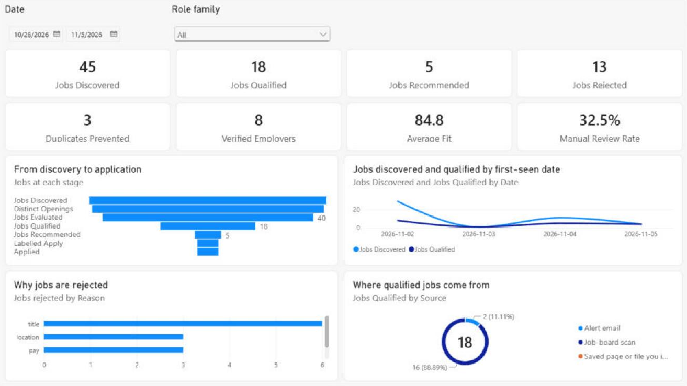
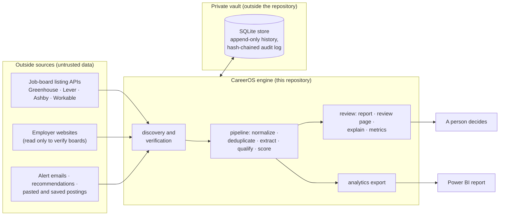
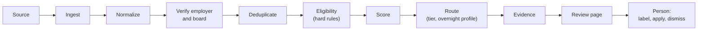

# CareerOS

**An evidence-driven job-search operations and decision-support platform:** CareerOS discovers openings, verifies their
source, rejects those that fail a stated hard requirement, ranks the rest for a person to review and records the reason
for every decision. This public snapshot does not submit job applications or contact employers or recruiters.



*Executive Overview from an earlier synthetic demo run. The November 15 walkthrough and gate use the updated fixture.*

**Built by Christopher Little**, product owner and business systems analyst, for their own job search. Chris supplied
or approved the requirements and screening rules, made the product, privacy and release decisions, reviewed the work
by using it, labelled the 50 postings behind the calibration and wrote the private Power BI measures. Claude
(Anthropic) implemented the code, tests and documentation under Chris's direction; Codex (OpenAI) reviewed it
independently; ChatGPT helped design it. Full account: [My role](docs/portfolio_overview.md#my-role) in the portfolio
overview and [AI-assisted development](docs/ai_assisted_development.md). Below, "I" and "the owner" are Chris; "the job
seeker" is Chris on the private system and a fictional person in Demo Mode.

## Start here

- **Hiring managers:** [What I owned](docs/portfolio_overview.md#my-role) · [Case study](docs/case_study.md).
- **No-install demo:** [Read the checked demo examples](docs/demo_walkthrough.md#view-without-installing) · [synthetic dashboard screenshots](powerbi/screenshots/).
- **Power BI:** [My separate Power BI showcase](https://github.com/crlittle20/careeros-powerbi-showcase) has the Power Query grouping column, DAX measures and report page I built, with AI guidance, on this project's synthetic demo export; its README credits each part.
- **Technical reviewers:** the demo runs offline on synthetic data and needs no credentials: [Quickstart](#quickstart), then the [reviewer walkthrough](docs/demo_walkthrough.md). Read next: [Architecture](docs/architecture.md) · [AI-assisted development](docs/ai_assisted_development.md) · [Demo Mode](docs/demo_mode.md) · [security architecture](docs/security_architecture.md) · [business requirements](docs/business_requirements.md) · [November 26 demo gate](docs/functional_mvp_report.md#8-later-changes) (the build assistant's self-assessment) · [CI runs](https://github.com/crlittle20/careeros/actions/workflows/ci.yml?query=branch%3Amain).

**Results**

- The suite contains 2187 automated tests, run with outbound network refused. The public repository's CI runs the same
  validation; this version's CI result comes with its publication.
- 2529 planted defects: the latest full run (2026-11-05) caught all 1066 defined at the time, each with a failing test
  (`evidence/mutation-receipt.json`). Each change since was checked by hand instead of a new full run: every defect in
  a file it changed, or added since, was planted again, and the suite had to fail. Each check ended with every one
  caught: a survivor got a new or corrected test (or its code, which no route ran any more, was removed), and the few
  defects that depend on the Python version were caught on 3.12.10, the runtime a rollback returns to. The latest
  check, after the last change (2026-11-26), scoped to the fix for Codex's eighteenth pass, planted 30 and
  caught 30 (`evidence/mutation-hand-check-67bbb76.json`). Every check, with what it found, is in
  [testing.md](docs/testing.md).
- In Chris's 50-posting calibration (2026-10-16), all six jobs the hard rules rejected were labelled Skip, and none of
  the 33 Apply or Stretch postings were hard-rejected. This is an in-sample check, not an accuracy estimate;
  ranking effectiveness is not demonstrated ([limitations](#limitations)).

### Project status (2026-11-26)

- First published 2026-10-15 (UTC). This version publishes the code as of 2026-11-26: the fixes from Codex's
  independent review of the screening rules, which ran nineteen passes after the 2026-11-15 snapshot; the nineteenth
  found no unresolved blocker (its recommendation is advisory, not release approval). Two rules change how the job
  seeker's decisions are kept. An Apply or Stretch label now approves exactly the posting it is given on, from a
  preview of that posting as read; if what the posting states changes later, the label holds until it is given
  again from a fresh preview. Only the same posting, by its exact link, is a duplicate; postings that only look
  alike are linked for review, never merged. The review's findings and fixes are listed below. These results come
  from the synthetic demo and tests, not from measured live use.
- The 2026-11-15 snapshot (the 2026-11-14 one already carried the items under "New since 2026-11-02") added the
  Functional MVP gate's full pass, 13 PASS, 0 PARTIAL, 0 FAIL. The five small gaps of its first assessment are closed:
  a posting whose location field says only
  "Remote" but whose text says the role is remote in the US shows that sentence as a hint with its location question
  (the text never sets the country, after Codex's review); `careeros sources list` shows suggested boards a probe found do not
  exist; a board migration that completes closes the old board's review cases about the move; and the demo world now
  has a board its employer's own site contradicts and an overnight job that NIGHT accepts. It also fixes a false
  warning when an agency digest's layout is recorded. These results come from the synthetic demo and tests, not from
  measured live use, and they were revised on 2026-11-16 after each pass of Codex's review (below and in the
  [report](docs/functional_mvp_report.md)). The snapshot before 2026-11-14 was that of 2026-11-02.
- New since 2026-11-02:
  - **Lead resolution** ([ADR 0003](docs/adr/0003-new-boards-are-quarantined.md) and
    [ADR 0001](docs/adr/0001-official-employer-sites-are-authoritative.md), amended 2026-11-02). A job seen only in a
    job alert or a recommendation is matched to the employer's own posting, on a board in the daily scan, by its own
    title, link, requisition and location, after every scan. A likely match waits for the job seeker to confirm or
    reject it, and `careeros leads unlink` corrects a wrong link with a recorded reason. A website named by a lead or
    by the curated employer list is only a hint: it helps find the employer's board, and the site counts as the
    employer's only through the site name it declares, read as a browser reads it.
  - **Python 3.14 and resilience** ([ADR 0008](docs/adr/0008-local-store-with-enforced-duties-and-audit-chain.md),
    amended 2026-11-03). The engine runs on Python 3.14 (before: 3.12.10, kept for a rollback), and both installs are
    hash-locked. An engine refuses a database newer than itself unless the newer migration allows it, and only a
    command holding the writer lock migrates. An optional encrypted offsite archive of the backups is decrypted back
    and compared before it is kept, and a weekly drill opens the newest one.
  - **Requirements read more closely.** A line asking for years as a role, in a function or doing an activity is
    judged on that ([Experience Match](docs/experience_match.md)); skills offered as alternatives are credited by the
    best one held; with pay listed by location, the range for the job seeker's state is used when the posting says
    which applies.
  - **Fail-safe readings.** Where CareerOS cannot be sure how to read a requirement (a years figure, a pay period or
    tier, where the job seeker must live, a certification), the job is marked to verify (CONDITIONAL) instead of
    being rejected or passing silently. Of the years requirements, only total professional years still reject on
    their own; a clearly stated pay range below the floor, or a location outside the U.S., still rejects as before.
    The accepted cost is more jobs to check by hand.
  - **Job-alert intake.** A readable link in a job alert whose job CareerOS cannot identify with certainty (an
    unrecognised job ID, two IDs that disagree, a redirect it cannot read) is kept as a lead to review, never matched
    to a job by itself; a link that cannot be read at all is counted as skipped. Job-alert digests from a staffing
    agency (off unless set up) are read from the email alone, never by following a link or visiting the agency's
    site: each job card read from a supported digest is kept as a local lead, never exported or matched to an
    employer's posting, because the agency's client is never guessed. A digest that cannot be read safely (an
    attachment, an unexpected format, or words about an application or an interview) is held for the job seeker to
    review, and no lead is taken from it.
  - **Applications measured.** Each application records what it rests on (the evidence given when it was
    recorded). One made through an assist session also records how it was made (by hand, with the employer's own
    autofill or with the browser extension) and, when the job seeker reports them, the minutes it took (revision 3 of
    the analytics export; without a session these fields stay empty). A follow-up the job
    seeker sent is recorded as an event, and every view uses one reminder rule: while an application waits for a
    response, a follow-up is due 14 days after the later of entering that state and the latest recorded follow-up. A
    form's full-name box is filled from an approved answer.
- Codex (OpenAI) reviewed each batch up to 2026-11-14. Its last review of the two largest batches still reported
  findings; the owner closed them with the fail-safe changes above, checked with targeted tests and planted defects,
  without a further independent review. Codex reviewed the changes of 2026-11-15 after they were published: its first
  pass found one High and five Medium problems (the US placement read wording about a team, clients or work
  authorization; migration and missing-board records could be wrong; some gate checks could pass with the output
  missing), and two Low ones. Fixes followed on 2026-11-16, and the older rule that placed any posting naming
  "United States" went with them. Codex's second pass found three resolved and five partly resolved (the US placement
  among them), its third pass two more resolved and three still partly resolved, and its fourth pass the
  link replacement resolved with the US placement still open: new wordings beat every text rule. The owner then chose
  to make the text a hint only: the location field alone sets the country, and the location question quotes the
  text's US sentence for you to check. Its fifth pass confirmed that, and found three routes that still skipped the
  location check (a state list in the text, a paste's location read from its prose, and scores made under the old
  rule before the first re-screen); those were corrected. Its sixth pass confirmed the hold on old scores and found
  two more routes: a blank "Location:" label took the next line of prose as the location, and a paste saved by the
  older parser kept a location read from its prose, which one re-screen made eligible again. Now a label's value must
  be on the label's own line, and an older paste whose location is neither its own "Location:" line nor one you gave
  places nothing until you confirm it (paste it again with `--location`). Its seventh pass found four more routes: a
  vertical tab, form feed or next-line control after a blank "Location:" was deleted before the label was read,
  joining the label to the prose; a later sighting changed how a job got its location, and a paste whose sighting was
  lost read as one added another way; a paste of a different opening (same employer and title, another link) could
  confirm its location onto a tracked posting; and an interrupted confirmation, or a score made before the provenance
  rule, could still route a package before processing. Now every line-ending control ends a line before anything is
  stripped; where a manual job's location came from is recorded with it, in one transaction, and a later sighting
  never changes that; only the same posting pasted again (its own link, or the same text when neither has a link)
  with `--location` confirms a location; a job waiting to be re-screened gets no standing package (by batch, `package
  prepare` or readiness), while a job you labelled keeps its route, by the owner's choice, and assistance refuses it
  until its eligibility is current; and a new rule version holds every older score until the job is re-screened. A
  manual job saved before this rule is placed by its stored location only when that is its own same-line "Location:"
  that does not run past a sentence end, or when those words are not in its text at all; otherwise you confirm it
  first. Its eighth pass confirmed those, and found two ways one opening could still stand in for another: two
  openings of one portal whose links differ only after "#" ("/portal/#/opening/R-1101" and "...R-1102") counted as the
  same posting, and two employers whose names make the same job ID ("A&B Health", "A B Health") let the second paste
  overwrite the first job. Now the same posting means the same link with its part after "#" (tracking parameters
  aside), or the same text when neither has a link, and never a different requisition number; and a new posting whose
  generated ID another posting holds gets its own ID, linked to the other as a possible duplicate, while the existing
  job is never touched (the owner's choices). Its ninth pass confirmed the portal case on a paste and found where the
  rule still fell short: two links that are not full addresses ("jobs.example.com/apply/...") counted as the same
  posting; `add-url --text-file` and the saved-file import still dropped the part after "#", so a second opening
  overwrote the first; and retrying a colliding saved import added a row each time and finally never finished. Now a
  link confirms only when both sides are full http(s) links (otherwise it says why); every manual route keeps the
  opening's own link and writes a job ID only when it holds this same posting, whatever the employer; a posting that
  comes again finds the job it was given before, the search for a free ID is bounded, and leads link to the job
  actually written. Its tenth pass confirmed the full-link rule and found three last gaps: the older duplicate check
  and lead linking still ignored the part after "#", so a second portal opening was made a duplicate of the first and
  its lead went to the first; two saved pages with no link and the same description merged across employers; and a
  refused or failed import was still filed as imported. Now the duplicate check and lead linking keep the "#" part
  (a second opening is linked for review, never made a duplicate); with no link, the same posting needs the same text,
  employer and title; and leads are linked and a file filed as imported only after a committed write, while a refused
  or failed file goes to the inbox's failed folder (the owner's choices). Before the eleventh pass, a Claude red team
  (four reviewers, each reproducing what it found) turned up more, all corrected: a location field naming the US and
  another country ("Remote - Canada (US hours)") or excluding the US now places a posting nowhere (a location
  question), and a saved page's country code ("CA") is read as the country, never a US state; a prose line such as
  "Location-based pay: ..." is no label; only an app route ("#/opening/R-1101") after "#" names an opening, never a
  page anchor ("#app"); two openings at one shared link are the same posting only under the same title with no other
  requisition, and a link that is not a full address is kept, never dropped; with no link, the location must agree
  too; the duplicate check reads every job at a link; and an alert's link that could not be stored keeps its lead open
  and its email in the failed folder. Codex's eleventh pass confirmed three of those and found six more gaps: a
  posting from another employer at a shared careers link could stand in for the tracked one; a lead or alert at a
  shared link joined an opening whose title or requisition differed; a requisition number hid another opening at a
  shared link; an alert email read a portal link without its "#" route; an alert line not stored was skipped when the
  email was read again; and location fields such as "Remote - Ecuador (US hours)" still placed a posting in the US.
  Each text rule had been beaten in turn, so the owner chose a structural fix (D180). Standing preparation now picks
  only a job board's own scan whose location field is plainly a US place: every part a US place or a neutral word
  ("Remote", a US time zone), else the location stays a question. A posting you paste, add or save, or one read for an
  alert, waits for your Apply or Stretch label. A paste never changes a tracked job's location; you set it by naming
  the job (`careeros location JOB "..."`). Everything a posting states (its link with the "#" route, title,
  requisition, employer) must agree before one stands in for another; an alert keeps a portal link's route; and an
  alert line not stored is read again. Generated property tests check both rules over thousands of combinations.
  A second Claude red team on that build (four reviewers again) reproduced about 16 High and 10 Medium problems, all
  corrected under the owner's choices (D181): the location field is read only as plain text (a part in another script
  or with look-alike letters left it US), "US" before a time word is a time zone, never a place, a state code a country
  shares counts only in a list of state codes or as "City, ST, US", and a filler word alone ("In") is no neutral part;
  Lever and Ashby postings now show every location their board lists; the duplicate check and lead matching compare
  the employer and a requisition however it is written, and at a link several openings share, the title (a stated
  level or Remote/Onsite must agree); a second opening at a shared link in another place gets its own job; alert links
  keep the query that names their opening, and a careers page in an alert keeps one lead per title; a score made under
  an earlier profile, or a Skip anywhere in the role, holds standing preparation. Codex's twelfth pass found three
  more routes into standing preparation (a single-link fetch replaced a scanned posting's location while keeping the
  scan's authority; "Remote - US?" read as a US place; Workable's typed country codes read as state codes) and four
  identity gaps at shared links. The owner chose (D182) to fix those routes in place and never to merge at a page
  several openings share: standing preparation needs a location the board's own listing scan wrote or confirmed; a
  field that asks, trails off or leaves a bracket open places nothing; a provider's typed country is written out
  ("Canada", never "CA"); at a link that names no single posting, nothing is made a duplicate, linked or matched by
  the link, so each posting and lead there stays for your review; a year in a link is no job number; an alert card
  keeps its stated employer, place and requisition; and an alert whose retry fails stays pending. A third Claude red
  team, on those corrections only (the owner asked to run only on the blockers), reproduced 19 more problems, all
  corrected: a link names one posting only in a strict form (a job number right after a job route, a job site's id
  key, a portal route such as "#/opening/R-1", a Workday requisition), never a search, listing or filter page; a
  paste matches by its link only when that link names one posting; an alert card's identity is everything its line
  states but its age; "US" beside a time zone ("Time Zone: US") is no place; a listing scan that cannot store a
  posting withdraws the earlier scan's confirmation; and an alert line not stored keeps its email or GitHub issue
  open, a Gmail one read again by its id. Codex's thirteenth pass then found three more inputs that reached standing
  preparation (a failed database write left an earlier scan's US location in force; "Remote (US: Time Zone)"; a
  Workable job's own country dropped) and three identity gaps. The owner turned standing preparation off (D183): no
  package is prepared, and no assistance opens, without your Apply or Stretch label. "US" beside a time zone, in either
  order, places nothing; a Workable job's own country abroad is written; a year or date in a job query or portal route
  names no posting; a second opening at a careers page never takes the first one's place; and a Greenhouse id on a
  careers-page link joins a job only when the line agrees. Codex's fourteenth pass found three more gaps: an assisted
  handoff issued under standing preparation before the change could still be returned by its key; a Greenhouse
  link guessed from a careers page linked a lead the conflict check had refused; and "/jobs/archive_2026" still
  named one posting, so a second opening there took the first one's Apply label. The owner chose to end that class of
  link findings (D184): only a job board's posting link (Greenhouse, Lever, Ashby, Workable, Workday) or a job
  site's id (LinkedIn, Indeed, Glassdoor) names one posting, and any employer careers page is treated as shared. A
  standing session's handoff is withdrawn. A Greenhouse link suggested by a shared careers page stays a notice for
  you, and a link CareerOS fetches for an alert line becomes that line's posting only when the link names one posting
  by itself (a job board's posting link or a job site's id), never because its title agrees with the line.
  Codex's fifteenth pass found five more gaps (D199): the label card did not show everything the approval covers
  (the posting's text and other fields, a copy cut short, pay rounded); a saved page's unrecognized pay unit was cut
  to 40 characters; a board read of one posting could clear a hold that reaches every job; P1 read the pending-holds
  file twice for one decision; and that file was rewritten in place. Each is fixed with tests that fail on the
  build it reviewed; the card now shows the whole posting, from one renderer, on every surface. Codex's sixteenth
  pass found three more (D200): a copy's stored pay and employer entry were hidden behind their summary lines (a
  stored 0–0 per hour showed only "not stated"); a paste running past the 60,000-character limit was answered by the
  receipt of the same posting ending at it, so its cut mark never reached the label check; and a read-only check
  could miss a hold moving from the pending-holds file into the database. Each is fixed with tests that fail on the
  build it reviewed. A stored 0–0 still reads as pay not stated, and every such line says what is stored (the owner's
  choice). Codex's seventeenth pass found one more (D201): a paste whose typed title, company or location ran past
  its limit could keep other words under the same receipt, so a changed reading never reached the label check. The
  receipt now binds what was kept, a blank typed field counts as not given, and a typed company is read from its
  canonical form, as is add-url's employer for its job id; tests fail on the build it reviewed. Codex's eighteenth
  pass found one more (D203): a copy that stated, in the same words, a value the stored record marked as filled in or
  cut read as unchanged when that was the record's last mark, so its sighting never reached the label check. Such a
  copy now counts as a change, and the comparison only gains changes; tests fail on the build it reviewed. Codex's
  nineteenth pass confirmed this fix and the one for its seventeenth pass, and found no new Critical or High problem.
- The 50 labelled postings behind the calibration and the owner's Power BI report on real data stay private.

## Project summary

| | |
|---|---|
| What | A local, single-user Python application: a daily pipeline, a command line, a local review page and a Power BI report |
| For | One real job search. Designed for healthcare operations and business-systems roles, including claims and pharmacy-benefit work. It runs daily on the owner's machine. |
| Shown publicly through | Demo Mode: the same production code on fictional employers, offline, with no credentials |
| Size | About 29,100 lines of Python in the engine and 30,400 in tests; 43 database tables; 43 commands |
| Documented by | 121 numbered requirements (109 requirements and 12 acceptance criteria), consolidated from the specifications and the built system and traced to code and tests ([business requirements](docs/business_requirements.md), [traceability](docs/requirements_traceability.md)), and 9 architecture decision records ([ADRs](docs/adr/README.md)) |
| Built with | A human-directed, AI-assisted workflow: the owner directed and decided, ChatGPT helped design and challenge, Claude implemented ([how](docs/ai_assisted_development.md)) |
| Status | Phase 1 (discovery and qualification) is in daily private use. The public repository's code is a generated snapshot of the private development repository; its documentation and dependency locks were also updated directly in the public repository on 2026-10-29, and the private repository carries the same corrections ([limitations](#limitations)). |

## Business problem

In a specialised field, job searching is an operations problem more than a search problem:
- **Volume.** Thousands of postings change daily across employer job boards, alert emails and recommendations.
- **Duplication.** One opening arrives through several channels, locations and reposts. Each copy costs time and risks
  a double application, which can break an agency's right to represent.
- **Hidden eligibility.** Remote rules, allowed states, degree, licences, years, seniority and pay are buried in free
  text.
- **Unreliable sources.** A job board can belong to a different company with the same name. Postings go stale or are
  scams. Pay shown by aggregators is often an estimate.
- **Misleading titles.** Relevant work hides behind generic titles such as "Operations Specialist" or "Analyst II".
- **Privacy.** The profile, pay floor and applications are personal.
- **No feedback loop.** Nobody measures whether the screening agrees with the job seeker's own judgement.

## Solution

**Conversion over volume:** surface fewer, better-qualified openings, each with the reasons behind its place, so the
time goes into applying rather than screening. Five principles run through the design:
1. **Evidence for every decision.** Each rejection, flag and score is stored with its reason, the posting text it
   rests on, and fingerprints of the rules and profile in force.
2. **Conservative with sources.** Only four public listing APIs are read automatically, and a job board is admitted
   only when the employer's own website points to it.
3. **Unknown is never a match.** A fact the posting does not state is a flag to check, scored as neutral.
4. **Private by construction.** Personal data lives in a vault outside the repository; secrets live in the operating
   system's credential store.
5. **A person decides.** CareerOS prepares and explains; applying, messaging and anything that reaches outside need a
   person ([ADR 0007](docs/adr/0007-human-approval-at-selected-stages.md)).

## Key capabilities

| Capability | What it does |
|---|---|
| Discovery | Reads the public listing APIs of Greenhouse, Lever, Ashby and Workable. Also reads alert emails (Gmail API, IMAP or saved `.eml` files), a private recommendations inbox, and postings the job seeker pastes or saves. Links to sites that are never automated become leads for a person to open. |
| Employer verification | Admits a board only after the employer's own website links to it and the board agrees about who it belongs to. New boards are quarantined until a validation scan passes. |
| Normalization | Remote scope (nationwide, restricted states, hybrid, onsite, international, unknown), state limits, pay ranges and units, employment type, title family, freshness |
| Deduplication | Requisition-aware identity across channels; sightings, reposts and closures; one application per role across duplicates and agency channels |
| Eligibility | Hard rules with the posting line quoted as evidence. Only a hard requirement can reject; unknowns are flags. |
| Scoring and routing | Fit, career value and freshness give an apply priority and a tier. A separate profile judges overnight and part-time work without touching the main decision. |
| Certifications | Every certification a posting names is recorded: which one, its issuer, how the posting words it, whether the job seeker holds it (held, in progress or planned), and whether the match is exact, related or by family. Only a held credential satisfies a requirement; certifications add no score points. `careeros certifications` shows demand across target jobs ([details](docs/certifications.md)). |
| Submission holds | Permission to submit kept apart from qualification: an employer-level hold, read from policy with the employer resolved through its aliases, is cleared only by your release of one posting and one channel, never by a score, a label or a recorded application. Nothing submits for you ([ADR 0007](docs/adr/0007-human-approval-at-selected-stages.md)). |
| Shadow scoring | A read-only second opinion on the tiers: Qualification and Opportunity scored separately, with unknowns kept visible as a range instead of a neutral guess, a status (Tier A/B, Check First, Stretch review, Near-miss, Archive) and queues. `careeros eval --scoring` compares it with production and a simpler baseline on a read-only snapshot, one role counted once, and draws blind calibration lists for unbiased estimates. It changes no production tier; nothing is adopted without a prospective check ([details](docs/shadow_scoring.md)). |
| Experience gaps | Shadow-mode experience-gap analysis: each years requirement gets a 20-point Experience Match (shortfall, coverage, relevance) and the tier effect it would have. It is shown and measured against the job seeker's labels, and changes no tier until the owner turns it on ([details](docs/experience_match.md)). |
| Explainability | `careeros explain JOB` answers 14 questions about any job; `careeros sources explain` shows why a board is trusted |
| Employer intelligence | Stable employer records with aliases and official domains, three separate board scores, ATS migrations, provider outages, and a Career Fit score that sets how often each employer is scanned |
| Human review and tracking | A local review page, labels (apply, stretch, skip), a shortlist with the next step for each job, private application briefs drafted from the approved profile, application tracking through its own workflow, dismissals with reasons, title-screen audits, a hiring funnel |
| Analytics | A validated star-schema export and a five-page Power BI report |
| Auditability | Workflow matrices, append-only history, a hash-chained audit log and `careeros verify` |
| Demo Mode | The whole system on synthetic data, offline and credential-free |

## Architecture



- **One local store.** SQLite, with each component limited to the tables (and some columns) it owns, workflow
  matrices for every state change, append-only history enforced by triggers, and idempotency receipts
  ([ADR 0008](docs/adr/0008-local-store-with-enforced-duties-and-audit-chain.md)).
- **Policy as configuration.** Engine defaults in `config/policy/defaults.yaml`, merged with the job seeker's private
  overrides. Every decision stores the fingerprint of the policy and profile it was made under, so a change re-evaluates
  exactly the affected jobs.
- **Same code, two modes.** Private mode uses the vault and real sources; Demo Mode uses a throwaway vault and a
  synthetic world ([ADR 0004](docs/adr/0004-demo-mode-is-isolated.md)).

Details: [architecture](docs/architecture.md), [data lineage](docs/data_lineage.md), [job lifecycle](docs/job_lifecycle.md)
and the [decision records](docs/adr/README.md).

## Workflow

The daily run (`careeros run`, started once a day by Windows Task Scheduler) takes a single-writer lock and:
1. scans every admitted board, within a host allowlist and a request budget, and records each scan;
2. reads new alert emails and recommendations, if connected; links become graded jobs or leads;
3. verifies candidate boards and re-verifies boards that are due;
4. processes only what changed: normalize, deduplicate, read requirements, apply the hard rules, score, route;
5. writes the review page, a sanitised seen-jobs index and a verified backup, and notifies if something is worth a look.



A failure in one board, email, issue line or job is recorded as an exception and never stops the run. Each job moves
only through the transitions in `config/workflows/job.json`, and each transition writes its history row, the job's
current state and an audit event in one database transaction.

## Employer verification

A board found anywhere (an alert, research, a guessed name) is only a **candidate**. CareerOS reads the employer's own
website and admits the board only when the employer itself points to it
([ADR 0001](docs/adr/0001-official-employer-sites-are-authoritative.md)):
1. **Handshake.** The employer's homepage and careers page link to, embed or redirect to the board.
2. **Identity.** The board agrees: its own name, the official domain in its postings, or postings that name the
   employer. A board that names another company is rejected as an identity mismatch.
3. **Board Trust at least 85**, with every mandatory check passed. A score never replaces a missing handshake; 65 to 84
   goes to a person.
4. **Quarantine and a validation scan** before the first daily scan
   ([ADR 0003](docs/adr/0003-new-boards-are-quarantined.md)).

Three scores answer three different questions and never mix
([ADR 0002](docs/adr/0002-board-trust-health-and-career-fit-are-separate.md)):

| Score | Question | Built from |
|---|---|---|
| Board Trust | Is this the employer's board? | Verification evidence only |
| Board Health | Is it working? | Recent scan outcomes; provider outages are never held against an employer |
| Career Fit | Is the employer worth scanning often? | CareerOS's own history of relevant roles there: recency, volume, roles that reached a review tier, remote share, breadth |

Systems CareerOS never reads (Workday, iCIMS, SmartRecruiters and others) are recorded as manual-only
([ADR 0006](docs/adr/0006-unsupported-ats-systems-stay-manual.md)). When an employer moves to another provider, the old
board becomes history with its jobs kept and the new one is verified. A manual approval records a reason and expires,
and it can never override an identity mismatch, an unsafe address or a contradicting official site.

## Data quality

- Posting text is cleaned of hidden characters and escaped HTML before use.
- Links are canonicalised, so tracking parameters never create a new posting or board.
- Weaker sources (alerts, recommendations) never overwrite facts from the employer's own board.
- Pay is judged on the full range. Units are annualised. A range that straddles the floor, geographic tiers, or variable
  pay with no stated base is *unknown*, not a pass. Pay shown by aggregators never rejects a job.
- "Remote" alone is never read as nationwide; stated state limits are kept.
- Old postings are flagged as possibly stale, never hidden.
- A scan that suddenly returns far fewer postings is marked suspicious and closes nothing; only complete scans close
  jobs.
- Requirements text that cannot be read reliably goes to a person.
- Rows marked as drills or tests are excluded from every metric, and the analytics export reconciles with the
  application's own metrics before it writes anything.

The full list is DQ-001 to DQ-010 in the [business requirements](docs/business_requirements.md).

## Analytics

`careeros export` writes a star schema of 8 dimensions and 5 facts as 13 CSV files with a manifest. It validates the
structure and reconciles the figures with `careeros metrics` first; if any check fails, nothing is written. A private
export is refused inside the code repository.

The Power BI report (`powerbi/CareerOS.pbip`, with 46 measures) has five pages: Executive Overview, Employer
Intelligence, Job Pipeline, Role Intelligence and System Quality. The committed report, the sample export in
`samples/analytics_demo/` and the screenshots in `powerbi/screenshots/` all use **synthetic Demo Mode data**. Tables,
grain and measures: [data dictionary](docs/analytics_data_dictionary.md) and [dashboard spec](docs/powerbi_dashboard_spec.md).

## Security

| Area | Control |
|---|---|
| Private data | The vault must live outside the repository (enforced). Logs are redacted. |
| Secrets | Windows Credential Manager. The optional AI reader, off by default, also accepts an `ANTHROPIC_API_KEY` environment variable. Never in the repository, database, reports or logs |
| Untrusted content | Postings, emails, issues and web pages are data: escaped, never executed, and unable to change policy, scores or what is fetched |
| Employer websites | An SSRF-safe fetcher: https only, public addresses only, connections pinned to the checked address, every redirect re-checked, robots.txt, size and type caps |
| Job-board clients | Only the four listing-API hosts, redirects included, within request budgets |
| Local review page | 127.0.0.1 only, a secret token, a Host check, one-time form keys |
| Sites never automated | LinkedIn, Indeed, Glassdoor, aggregators and manual-only systems are never fetched. There is no CAPTCHA handling. |
| Acting on someone's behalf | No code applies or contacts an employer or recruiter. The only outward writes are replies and a sanitized index in the owner's own private GitHub inbox. |
| Releases | `tools/release_scan.py` finds secrets and personal data and never prints a matched value |
| Dependencies | Hash-locked development set (wheels only; every release at least 14 days old, except two security fixes recorded in the lock's header) and pip-audit |

Every control in the threat model is tied to a test and to a planted defect that the tests must catch. See
[SECURITY.md](SECURITY.md), [PRIVACY.md](PRIVACY.md) and the [security architecture](docs/security_architecture.md).

## Testing

| Layer | What it shows |
|---|---|
| 2187 automated tests | Unit and integration tests on synthetic fixtures, fake transports and fixed clocks, run with outbound network refused (`tools/offline_tests.py`); validation records passes, skips and unavailable checks separately |
| 2529 planted defects | `tools/mutate.py` breaks each safety rule in a scratch copy, and the test suite must then fail. A defect that survives is an untested rule. |
| Functional MVP gate | `tools/mvp_gate.py` runs the real command line in Demo Mode and makes 95 checks against expectations written from the postings and the policy, not read back from the system. Result: no requirement fails. Of 13, 13 are PASS and 0 are PARTIAL: the five gaps of the first assessment were closed on 2026-11-15 ([report](docs/functional_mvp_report.md)). |
| Documentation tests | The documents' named files, tests, tables and commands must exist |
| Static checks | ruff (pyflakes, bugbear and security rules), mypy against a recorded baseline of older errors, configuration checks |
| Release and supply chain | The release scan for secrets, and pip-audit of both dependency locks |

How the planted-defect runs work, in plain terms, is in [testing](docs/testing.md).

One command runs it all, the same command the CI workflow (`.github/workflows/ci.yml`) runs:

```
.venv-dev\Scripts\python.exe tools\validate.py            # lint, format, types, config, tests, Demo Mode, security
.venv-dev\Scripts\python.exe tools\validate.py --full     # plus every planted defect (slow: the suite runs once per defect)
```

## Demo Mode

`careeros demo tour` runs four simulated days of the real daily run on 16 fictional employers, their job boards and
their websites (`*.example.com`), plus an alert email, a pasted posting and a fictional job seeker. It runs offline in
a throwaway demo vault. While Demo Mode is on, the private vault cannot even be located, and the real network,
credentials, mail, GitHub, the clipboard, the AI reader and notifications are all refused. The tests prove it under a
"jail" that records any attempt to leave.

**Synthetic results** (fictional data, fixed by the tests): 46 jobs, of which 29 scored, 13 rejected with stated
reasons and 4 closed; 15 boards, of which 8 active, 2 rejected (an impostor, and a board its employer's own
site contradicts) and 1 awaiting review. These
numbers describe a hand-written world chosen to exercise every rule, not a real job market. See
[Demo Mode](docs/demo_mode.md) and the [reviewer walkthrough](docs/demo_walkthrough.md).

## Tech stack

| Area | Choice |
|---|---|
| Language and runtime | Python 3.14, standard library first |
| Storage | SQLite in WAL mode, 15 forward-only migrations |
| Dependencies | httpx (HTTP), PyYAML (policy), anthropic (an optional AI requirement reader, used only when an API key is stored) |
| Review page | The standard library's HTTP server, bound to 127.0.0.1 |
| Analytics | CSV star schema; Power BI project files (TMSL model and PBIR report) generated by `tools/build_powerbi_project.py` |
| Operations | Windows Task Scheduler, Windows Credential Manager, Windows notifications |
| Quality | unittest, a mutation tool, ruff, mypy, pip-audit, GitHub Actions |

## Quickstart

The hash-locked development set (`requirements-dev.lock`, wheels only) installs on CPython 3.14 (or 3.12) on Windows x64
or Linux x64, and on nothing else yet: Windows 10 and 11 are where the owner runs CareerOS, and the Linux install is
verified by the CI job. On macOS, or with another Python version, the install fails because no hashed wheel matches;
the [reviewer walkthrough](docs/demo_walkthrough.md) says what can be checked without installing.

First clone or download this repository and open its folder. Initial dependency installation generally needs internet
access; the demo itself then runs offline.

```
python -m venv .venv-dev
.venv-dev\Scripts\python.exe -m pip install --require-hashes --only-binary :all: --no-deps -r requirements-dev.lock
.venv-dev\Scripts\python.exe -m careeros demo tour
```

The commands are written for Windows. On Linux, use `python3` to create the virtual environment and
`.venv-dev/bin/python` for the later commands.

Then explore the result with Demo Mode on (Command Prompt syntax; in PowerShell use `$env:CAREEROS_DEMO_MODE = "true"`;
on Linux, `export CAREEROS_DEMO_MODE=true` to switch it on and `unset CAREEROS_DEMO_MODE` to switch it off):

```
set CAREEROS_DEMO_MODE=true
.venv-dev\Scripts\python.exe -m careeros explain greenhouse:meridianrx:101
.venv-dev\Scripts\python.exe -m careeros sources health
.venv-dev\Scripts\python.exe -m careeros review          # the review page; Ctrl+C stops it
set CAREEROS_DEMO_MODE=
```

And run every check: `.venv-dev\Scripts\python.exe tools\validate.py --offline` (on Linux,
`.venv-dev/bin/python tools/validate.py --offline`).

The [reviewer walkthrough](docs/demo_walkthrough.md) goes from here through every part of the system in about ten
minutes, with the output to expect. In the documentation, `careeros <command>` means
`.venv-dev\Scripts\python.exe -m careeros <command>`, run from the repository folder.

Using CareerOS for a real search needs a vault folder outside the repository (`CAREEROS_VAULT`), `careeros init`, an
approved profile and policy overrides in the vault, and `careeros run` once a day.

## Limitations

- **Single user, local, Windows.** The full validation also passes on Linux in CI, where that job is informational;
  the daily-run setup (Task Scheduler, Credential Manager, notifications) is Windows-only. The hash-locked install is
  for CPython 3.14 (or 3.12) on Windows x64 or Linux x64 only; macOS is unsupported and untested.
- **CI runs only on the public repository.** The private development repository has no remote. The first run
  (2026-10-15) passed on Windows (required) and Linux (informational).
- **Four providers.** Only Greenhouse, Lever, Ashby and Workable are read automatically. Other systems are manual
  by design, and LinkedIn, Indeed and Glassdoor are never automated.
- **Static pages only.** A careers page that builds its job list with JavaScript cannot prove a board; such boards
  wait for a person.
- **Rules-based reading.** Requirements are read by deterministic rules. The AI reader is optional, needs an API key,
  and is switched off in the owner's own setup.
- **Ranking effectiveness not demonstrated (measured 2026-10-16).** I labelled 50 real postings (22 Apply, 11
  Stretch, 17 Skip), and a calibration compared the decisions of the scoring code published on 2026-10-16 with them.
  The hard rules agreed with my 50 labels (in-sample): they rejected 6 labelled jobs, all labelled Skip, and none of
  the 33 Apply or Stretch jobs. The ranking did not: none of the 22 Apply jobs reached the top tiers (A/B), and scored
  Apply and Skip jobs had the same average priority to one decimal place (70.3), although eligibility score and skill
  coverage did separate them. The sample is small, comes from one person, mostly on jobs the review page showed, and
  no tier rule in this repository has been changed in response or checked on new labels
  ([shadow scoring](docs/shadow_scoring.md) is read-only and not adopted). The Phase 1 exit test asks for at least 50
  labels with measured agreement. Not claimed: the coded thresholds were met, but the precision figure rests on one
  top-tier job, the recall figure rests on a private near-miss setting, and nothing in the test counts how many wanted
  jobs reach the top tiers ([calibration](docs/case_study.md#ranking-calibration-identify-measure-improve-validate)).
  The source-expansion targets are provisional.
- **Known gaps.** Type checking runs against a baseline of 158 older errors. The Functional MVP gate's five small
  gaps were closed on 2026-11-15 (13 PASS, 0 PARTIAL); the gate is Claude's own assessment, not an independent one.
- **Generated, not mirrored.** The public repository's code is a snapshot generated from an allowlist, with fresh
  history ([release checklist](docs/public_release_checklist.md)). Its documentation and dependency locks were also
  updated directly in the public repository on 2026-10-29; the private development repository carries the same
  corrections. The private development repository's history still holds private settings and is never published.

## Roadmap

**Portfolio release:** The November 15 snapshot closed the original Functional MVP gaps in the synthetic demo gate;
this one adds the fixes from the independent review that followed, whose nineteenth pass found no unresolved
blocker. See the [dated results](docs/functional_mvp_report.md#8-later-changes) and the
[project status](#project-status-2026-11-26). The demo gate is the build assistant's self-assessment, not deployment
approval.

**Product:**
- Improve the tier rule that the 2026-10-16 calibration found weak, test any change side by side on new labels before
  adopting it, and add to the exit test a measure of how many wanted jobs reach the top tiers; then measure the
  source-expansion pilot.
- Decide how to handle JavaScript careers pages (pending a review of a week of verification results).
- Review the lead-matching path; reduce the type-check baseline; decide whether the Linux CI job becomes required.
- Decide whether to enforce Experience Match once `careeros eval` reports it calibrated (50 labels, 20 of them with a
  years requirement).
- Assisted applications are built ([ADR 0009](docs/adr/0009-assisted-applications.md)): versioned packages prepared
  from the approved profile, and form filling only at the person's request; the person always submits. Filling stays
  off for each destination until its installed-extension check. Next: compare assisted with manual applications
  (`careeros assist report`), and build an adapter for another destination only where that shows time saved.

**Deferred:** automatic applications. CareerOS applies to nothing today. A later phase may let the job seeker promote a
channel to automatic submission after a clean record, under its own decision record
([ADR 0007](docs/adr/0007-human-approval-at-selected-stages.md)).

**Scope:** a local, single-user desktop tool; not a hosted or multi-user product.
