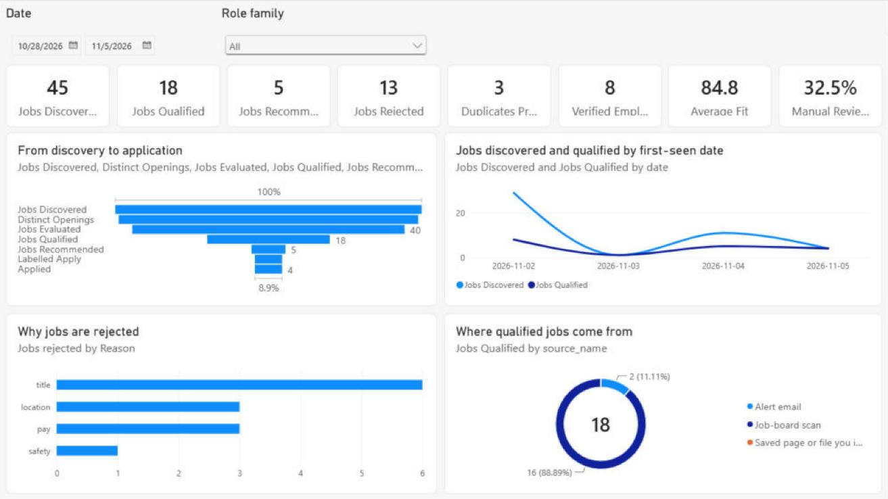
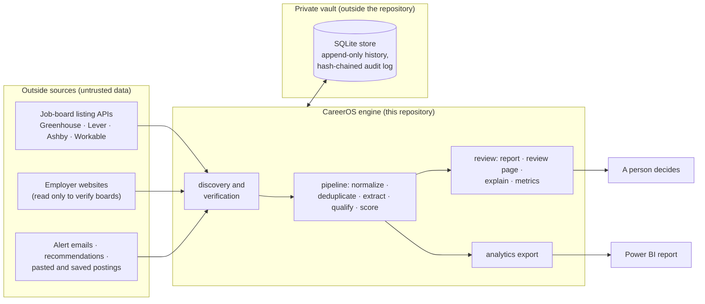
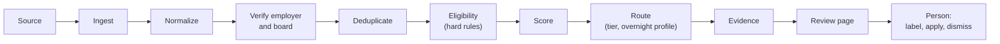

# CareerOS

**An evidence-driven job-search operations and decision-support platform.** CareerOS discovers job openings, validates
where they come from, normalizes them, rejects those that fail a stated hard requirement and ranks the rest for a person
to review. Along the way it builds intelligence about employers and keeps an auditable record of every decision.

It does not apply for jobs. A person reads its short, explained list and decides; CareerOS has no code that submits
an application or contacts an employer or recruiter.

**Built by Christopher Little**, product owner and business systems analyst, for my own job search. I defined the
problem and the acceptance criteria, set my own screening rules and approved the rest, and made the product decisions.
Claude (Anthropic's AI coding assistant) wrote the code and tests under my direction, and ChatGPT was the design
partner.
[My role in detail](#who-built-this-and-my-role).



*The Executive Overview page, on Demo Mode data. Every number in the screenshots is synthetic.*

### Executive summary

CareerOS treats a job search as an operations problem: high volume, duplicate postings, eligibility rules buried in
free text, and sources that cannot be taken at face value. This local Python system collects openings daily from
job-board listings and alert emails, checks that each job board belongs to the employer, catches duplicates, rejects
jobs that fail a stated hard requirement, scores the rest and records the reason for every decision. A person reviews
the result and decides; nothing is applied for automatically. I defined the problem, supplied or approved the
business rules, set the acceptance criteria, and made or approved the product, privacy and release decisions. Claude,
an AI coding assistant, wrote the code; ChatGPT helped design it. I labelled 50 real postings, and a first calibration
against them (2026-10-16) found that the hard rules agreed with my 50 labels (in-sample), but that the ranking does not
yet separate the jobs I want from those I would skip.

For hiring managers, the [portfolio overview](docs/portfolio_overview.md) maps each skill to its evidence and includes
a two-minute tour.

### Who built this, and my role

I'm Christopher Little. CareerOS is my project, built for my own job search. I was its **product owner and business
systems analyst**. Claude, an AI coding assistant, wrote the code; ChatGPT helped design it. What I did:

- Defined the problem and the goal: fewer, better-qualified openings, not more applications (quality over volume).
- Supplied my own facts and personal rules (profile, pay floor, location rule, which job titles count) and approved
  the rest of the screening rules.
- Set the acceptance rule for every milestone (tests passing, regressions fixed, a written report, open issues listed)
  and approved the two MVP gates.
- Made the decisions put to me, and overrode the AI twice on tier rules (a skill-coverage minimum for the top tiers; a
  second, broader tier of job titles my experience counts for).
- Judged the work by using it: labelled 50 real postings and sent work back when it did not match what I meant.
- Set the privacy requirements, approved the MIT licence and approved publication.

More detail, skill by skill: the [portfolio overview](docs/portfolio_overview.md). In these documents, "the owner"
means me; "the job seeker" means me on the private system and a fictional person in Demo Mode.

**Who wrote the code.** Claude, an AI coding assistant, wrote the code and tests, and the script that generates the
Power BI files, under my direction. ChatGPT (OpenAI) was the design and analysis partner: it drafted the main
specifications and the Phase 1 audit (its audit of the first phase); I chose which were built and decided their open
questions. Claude consolidated those specifications and the built system into 113 numbered requirements traced to code
and tests.
Claude also made lower-level technical choices and, once, at my instruction, a night's sixteen design decisions,
logged for my review. Details: [AI-assisted development](docs/ai_assisted_development.md).

### Skills shown, and the evidence

For business systems analyst, automation analyst and process improvement analyst roles. The
[portfolio overview](docs/portfolio_overview.md) has a fuller map.

| Skill | Most relevant to | My part | Evidence |
|---|---|---|---|
| Problem framing | Business systems, process improvement | Defined the problem and the goal: quality over volume | [Business problem](#business-problem); [case study](docs/case_study.md), sections 1-2 |
| Requirements and acceptance criteria | Business systems | Supplied or approved the requirements; set the acceptance rule for every milestone and approved the two MVP gates | [business requirements](docs/business_requirements.md); [traceability](docs/requirements_traceability.md); [Functional MVP report](docs/functional_mvp_report.md) |
| Business rules and decision logic | Business systems, automation | Supplied my own facts and personal rules (profile, pay floor, location rule, which job titles count) and approved the rest of the screening rules; required a skill minimum for the top tiers and a second tier of experience titles, overriding the AI's recommendation both times | `config/policy/defaults.yaml` (public defaults); [architecture](docs/architecture.md), section 5; [AI-assisted development](docs/ai_assisted_development.md), section 6 |
| Workflow and process design | Business systems, process improvement | Made or approved the product and workflow decisions; accepted, redirected or sent back proposed designs at each milestone | [Workflow](#workflow); [job lifecycle](docs/job_lifecycle.md); [ADR 0007](docs/adr/0007-human-approval-at-selected-stages.md) |
| Automation with controls | Automation | Chose which milestones were built; approved scheduling, installs, downloads and publishing; new collection features were switched on only at my instruction | [Workflow](#workflow); [architecture](docs/architecture.md), section 3; `tools/validate.py` |
| Measurement and continuous improvement | Process improvement | Labelled 50 real postings; Claude ran the comparison for my decision. Improving and validating the ranking are not done yet. | [Ranking calibration](docs/case_study.md#ranking-calibration-identify-measure-improve-validate) |
| Testing and quality gates | All three | Set the acceptance rules; judged the running system and sent work back | [Testing](#testing); [Portfolio MVP report](docs/portfolio_mvp_report.md); `evidence/mutation-receipt.json` |
| Analytics and KPIs | Business systems, process improvement | Approved the milestone that built them. Claude wrote the export and the report generator | [data dictionary](docs/analytics_data_dictionary.md); [dashboard spec](docs/powerbi_dashboard_spec.md) |
| Privacy, security and release governance | All three | Set or approved the privacy requirements; chose a sanitized public snapshot; approved publication | [security architecture](docs/security_architecture.md); [release checklist](docs/public_release_checklist.md); [PRIVACY.md](PRIVACY.md) |
| Directing AI-assisted delivery | All three | Directed AI assistants through bounded milestones, each ending in tests, a report and my approval before commit | [AI-assisted development](docs/ai_assisted_development.md) |

### Project status (2026-10-29)

- First published 2026-10-15 (UTC); the code here was last updated 2026-10-16 (UTC; Experience Match and
  certifications).
- Documentation and dependency locks were updated 2026-10-29, directly in this public repository (not generated from
  the private engine).
- Private development continues on application-preparation tooling and scoring calibration; that work is not in this
  repository.

### For technical reviewers

The sections below describe the system itself: architecture, employer verification, data quality, analytics,
security, testing, Demo Mode and a quickstart.

**Try it:** the demo runs offline on synthetic data and needs no credentials. See the [quickstart](#quickstart).

Read next: [reviewer walkthrough](docs/demo_walkthrough.md) · [case study](docs/case_study.md) ·
[architecture](docs/architecture.md) ·
[AI-assisted development](docs/ai_assisted_development.md) · [Demo Mode](docs/demo_mode.md) ·
[security architecture](docs/security_architecture.md) · [business requirements](docs/business_requirements.md)

## Project summary

| | |
|---|---|
| What | A local, single-user Python application: a daily pipeline, a command line, a local review page and a Power BI report |
| For | One real job search. Designed for healthcare operations and business-systems roles, including claims and pharmacy-benefit work. It runs daily on the owner's machine. |
| Shown publicly through | Demo Mode: the same production code on fictional employers, offline, with no credentials |
| Size | About 13,400 lines of Python in the engine and 6,800 in tests; 38 database tables; 33 commands |
| Documented by | 113 numbered requirements (101 requirements and 12 acceptance criteria), consolidated from the specifications and the built system and traced to code and tests ([business requirements](docs/business_requirements.md), [traceability](docs/requirements_traceability.md)), and 8 architecture decision records ([ADRs](docs/adr/README.md)) |
| Built with | A human-directed, AI-assisted workflow: the owner directed and decided, ChatGPT helped design and challenge, Claude implemented ([how](docs/ai_assisted_development.md)) |
| Status | Phase 1 (discovery and qualification) is in daily private use. The public repository's code is a generated snapshot of the private development repository; its documentation and dependency locks were updated directly here on 2026-10-29 ([limitations](#limitations)). |

## Business problem

In a specialised field, job searching is an operations problem more than a search problem:
- **Volume.** Thousands of postings change daily across employer job boards, alert emails and recommendations.
- **Duplication.** One opening arrives through several channels, locations and reposts. Each copy costs time and risks
  a double application, which can break an agency's right to represent.
- **Hidden eligibility.** Remote rules, allowed states, degree, licences, years, seniority and pay are buried in free
  text.
- **Unreliable sources.** A job board can belong to a different company with the same name. Postings go stale or are
  scams. Pay shown by aggregators is often an estimate.
- **Misleading titles.** Relevant work hides behind generic titles such as "Operations Specialist" or "Analyst II".
- **Privacy.** The profile, pay floor and applications are personal.
- **No feedback loop.** Nobody measures whether the screening agrees with the job seeker's own judgement.

## Solution

**Conversion over volume:** surface fewer, better-qualified openings, each with the reasons behind its place, so the
time goes into applying rather than screening. Five principles run through the design:
1. **Evidence for every decision.** Each rejection, flag and score is stored with its reason, the posting text it
   rests on, and fingerprints of the rules and profile in force.
2. **Conservative with sources.** Only four public listing APIs are read automatically, and a job board is admitted
   only when the employer's own website points to it.
3. **Unknown is never a match.** A fact the posting does not state is a flag to check, scored as neutral.
4. **Private by construction.** Personal data lives in a vault outside the repository; secrets live in the operating
   system's credential store.
5. **A person decides.** CareerOS prepares and explains; applying, messaging and anything that reaches outside need a
   person ([ADR 0007](docs/adr/0007-human-approval-at-selected-stages.md)).

## Key capabilities

| Capability | What it does |
|---|---|
| Discovery | Reads the public listing APIs of Greenhouse, Lever, Ashby and Workable. Also reads alert emails (Gmail API, IMAP or saved `.eml` files), a private recommendations inbox, and postings the job seeker pastes or saves. Links to sites that are never automated become leads for a person to open. |
| Employer verification | Admits a board only after the employer's own website links to it and the board agrees about who it belongs to. New boards are quarantined until a validation scan passes. |
| Normalization | Remote scope (nationwide, restricted states, hybrid, onsite, international, unknown), state limits, pay ranges and units, employment type, title family, freshness |
| Deduplication | Requisition-aware identity across channels; sightings, reposts and closures; one application per role across duplicates and agency channels |
| Eligibility | Hard rules with the posting line quoted as evidence. Only a hard requirement can reject; unknowns are flags. |
| Scoring and routing | Fit, career value and freshness give an apply priority and a tier. A separate profile judges overnight and part-time work without touching the main decision. |
| Certifications | Every certification a posting names is recorded: which one, its issuer, how the posting words it, whether the job seeker holds it (held, in progress or planned), and whether the match is exact, related or by family. Only a held credential satisfies a requirement; certifications add no score points. `careeros certifications` shows demand across target jobs ([details](docs/certifications.md)). |
| Experience gaps | Shadow-mode experience-gap analysis: each years requirement gets a 20-point Experience Match (shortfall, coverage, relevance) and the tier effect it would have. It is shown and measured against the job seeker's labels, and changes no tier until the owner turns it on ([details](docs/experience_match.md)). |
| Explainability | `careeros explain JOB` answers 14 questions about any job; `careeros sources explain` shows why a board is trusted |
| Employer intelligence | Stable employer records with aliases and official domains, three separate board scores, ATS migrations, provider outages, and a Career Fit score that sets how often each employer is scanned |
| Human review and tracking | A local review page, labels (apply, stretch, skip), a shortlist with the next step for each job, private application briefs drafted from the approved profile, application tracking through its own workflow, dismissals with reasons, title-screen audits, a hiring funnel |
| Analytics | A validated star-schema export and a five-page Power BI report |
| Auditability | Workflow matrices, append-only history, a hash-chained audit log and `careeros verify` |
| Demo Mode | The whole system on synthetic data, offline and credential-free |

## Architecture



- **One local store.** SQLite, with each component limited to the tables (and some columns) it owns, workflow
  matrices for every state change, append-only history enforced by triggers, and idempotency receipts
  ([ADR 0008](docs/adr/0008-local-store-with-enforced-duties-and-audit-chain.md)).
- **Policy as configuration.** Engine defaults in `config/policy/defaults.yaml`, merged with the job seeker's private
  overrides. Every decision stores the fingerprint of the policy and profile it was made under, so a change re-evaluates
  exactly the affected jobs.
- **Same code, two modes.** Private mode uses the vault and real sources; Demo Mode uses a throwaway vault and a
  synthetic world ([ADR 0004](docs/adr/0004-demo-mode-is-isolated.md)).

Details: [architecture](docs/architecture.md), [data lineage](docs/data_lineage.md), [job lifecycle](docs/job_lifecycle.md)
and the [decision records](docs/adr/README.md).

## Workflow

The daily run (`careeros run`, started once a day by Windows Task Scheduler) takes a single-writer lock and:
1. scans every admitted board, within a host allowlist and a request budget, and records each scan;
2. reads new alert emails and recommendations, if connected; links become graded jobs or leads;
3. verifies candidate boards and re-verifies boards that are due;
4. processes only what changed: normalize, deduplicate, read requirements, apply the hard rules, score, route;
5. writes the review page, a sanitised seen-jobs index and a verified backup, and notifies if something is worth a look.



A failure in one board, email, issue line or job is recorded as an exception and never stops the run. Each job moves
only through the transitions in `config/workflows/job.json`, and each transition writes its history row, the job's
current state and an audit event in one database transaction.

## Employer verification

A board found anywhere (an alert, research, a guessed name) is only a **candidate**. CareerOS reads the employer's own
website and admits the board only when the employer itself points to it
([ADR 0001](docs/adr/0001-official-employer-sites-are-authoritative.md)):
1. **Handshake.** The employer's homepage and careers page link to, embed or redirect to the board.
2. **Identity.** The board agrees: its own name, the official domain in its postings, or postings that name the
   employer. A board that names another company is rejected as an identity mismatch.
3. **Board Trust at least 85**, with every mandatory check passed. A score never replaces a missing handshake; 65 to 84
   goes to a person.
4. **Quarantine and a validation scan** before the first daily scan
   ([ADR 0003](docs/adr/0003-new-boards-are-quarantined.md)).

Three scores answer three different questions and never mix
([ADR 0002](docs/adr/0002-board-trust-health-and-career-fit-are-separate.md)):

| Score | Question | Built from |
|---|---|---|
| Board Trust | Is this the employer's board? | Verification evidence only |
| Board Health | Is it working? | Recent scan outcomes; provider outages are never held against an employer |
| Career Fit | Is the employer worth scanning often? | CareerOS's own history of relevant roles there: recency, volume, roles that reached a review tier, remote share, breadth |

Systems CareerOS never reads (Workday, iCIMS, SmartRecruiters and others) are recorded as manual-only
([ADR 0006](docs/adr/0006-unsupported-ats-systems-stay-manual.md)). When an employer moves to another provider, the old
board becomes history with its jobs kept and the new one is verified. A manual approval records a reason and expires,
and it can never override an identity mismatch, an unsafe address or a contradicting official site.

## Data quality

- Posting text is cleaned of hidden characters and escaped HTML before use.
- Links are canonicalised, so tracking parameters never create a new posting or board.
- Weaker sources (alerts, recommendations) never overwrite facts from the employer's own board.
- Pay is judged on the full range. Units are annualised. A range that straddles the floor, geographic tiers, or variable
  pay with no stated base is *unknown*, not a pass. Pay shown by aggregators never rejects a job.
- "Remote" alone is never read as nationwide; stated state limits are kept.
- Old postings are flagged as possibly stale, never hidden.
- A scan that suddenly returns far fewer postings is marked suspicious and closes nothing; only complete scans close
  jobs.
- Requirements text that cannot be read reliably goes to a person.
- Rows marked as drills or tests are excluded from every metric, and the analytics export reconciles with the
  application's own metrics before it writes anything.

The full list is DQ-001 to DQ-010 in the [business requirements](docs/business_requirements.md).

## Analytics

`careeros export` writes a star schema of 8 dimensions and 5 facts as 13 CSV files with a manifest. It validates the
structure and reconciles the figures with `careeros metrics` first; if any check fails, nothing is written. A private
export is refused inside the code repository.

The Power BI report (`powerbi/CareerOS.pbip`, with 46 measures) has five pages: Executive Overview, Employer
Intelligence, Job Pipeline, Role Intelligence and System Quality. The committed report, the sample export in
`samples/analytics_demo/` and the screenshots in `powerbi/screenshots/` all use **synthetic Demo Mode data**. Tables,
grain and measures: [data dictionary](docs/analytics_data_dictionary.md) and [dashboard spec](docs/powerbi_dashboard_spec.md).

## Security

| Area | Control |
|---|---|
| Private data | The vault must live outside the repository (enforced). Logs are redacted. |
| Secrets | Windows Credential Manager. The optional AI reader, off by default, also accepts an `ANTHROPIC_API_KEY` environment variable. Never in the repository, database, reports or logs |
| Untrusted content | Postings, emails, issues and web pages are data: escaped, never executed, and unable to change policy, scores or what is fetched |
| Employer websites | An SSRF-safe fetcher: https only, public addresses only, connections pinned to the checked address, every redirect re-checked, robots.txt, size and type caps |
| Job-board clients | Only the four listing-API hosts, redirects included, within request budgets |
| Local review page | 127.0.0.1 only, a secret token, a Host check, one-time form keys |
| Sites never automated | LinkedIn, Indeed, Glassdoor, aggregators and manual-only systems are never fetched. There is no CAPTCHA handling. |
| Acting on someone's behalf | No code applies or contacts an employer or recruiter. The only outward writes are replies and a sanitized index in the owner's own private GitHub inbox. |
| Releases | `tools/release_scan.py` finds secrets and personal data and never prints a matched value |
| Dependencies | Hash-locked development set (wheels only; every release at least 14 days old, except two security fixes recorded in the lock's header) and pip-audit |

Every control in the threat model is tied to a test and to a planted defect that the tests must catch. See
[SECURITY.md](SECURITY.md), [PRIVACY.md](PRIVACY.md) and the [security architecture](docs/security_architecture.md).

## Testing

| Layer | What it shows |
|---|---|
| 485 automated tests | Unit and integration tests on synthetic fixtures, fake transports and fixed clocks, run with outbound network refused (`tools/offline_tests.py`) |
| 305 planted defects | `tools/mutate.py` breaks each safety rule in a scratch copy, and the test suite must then fail. A defect that survives is an untested rule. |
| Functional MVP gate | `tools/mvp_gate.py` runs the real command line in Demo Mode and makes 92 checks against expectations written from the postings and the policy, not read back from the system. Result: no requirement fails. Of 13, 10 are PASS and 3 are PARTIAL, with the gaps listed in the [report](docs/functional_mvp_report.md). |
| Documentation tests | The documents' named files, tests, tables and commands must exist |
| Static checks | ruff (pyflakes, bugbear and security rules), mypy against a recorded baseline of older errors, configuration checks |
| Release and supply chain | The release scan for secrets, and pip-audit of both dependency locks |

One command runs it all, the same command the CI workflow (`.github/workflows/ci.yml`) runs:

```
.venv-dev\Scripts\python.exe tools\validate.py            # lint, format, types, config, tests, Demo Mode, security
.venv-dev\Scripts\python.exe tools\validate.py --full     # plus every planted defect (slow: the suite runs once per defect)
```

## Demo Mode

`careeros demo tour` runs four simulated days of the real daily run on 15 fictional employers, their job boards and
their websites (`*.example.com`), plus an alert email, a pasted posting and a fictional job seeker. It runs offline in
a throwaway demo vault. While Demo Mode is on, the private vault cannot even be located, and the real network,
credentials, mail, GitHub, the clipboard, the AI reader and notifications are all refused. The tests prove it under a
"jail" that records any attempt to leave.

**Synthetic results** (fictional data, fixed by the tests): 45 jobs, of which 27 scored, 13 rejected with stated
reasons, 1 duplicate and 4 closed; 13 boards, of which 8 active, 1 rejected as an impostor and 1 awaiting review. These
numbers describe a hand-written world chosen to exercise every rule, not a real job market. See
[Demo Mode](docs/demo_mode.md) and the [reviewer walkthrough](docs/demo_walkthrough.md).

## Tech stack

| Area | Choice |
|---|---|
| Language and runtime | Python 3.12, standard library first |
| Storage | SQLite in WAL mode, 12 forward-only migrations |
| Dependencies | httpx (HTTP), PyYAML (policy), anthropic (an optional AI requirement reader, used only when an API key is stored) |
| Review page | The standard library's HTTP server, bound to 127.0.0.1 |
| Analytics | CSV star schema; Power BI project files (TMSL model and PBIR report) generated by `tools/build_powerbi_project.py` |
| Operations | Windows Task Scheduler, Windows Credential Manager, Windows notifications |
| Quality | unittest, a mutation tool, ruff, mypy, pip-audit, GitHub Actions |

## Quickstart

Tested on Windows 10 and 11 with Python 3.12. The core is plain Python, but other platforms are not verified yet.

```
python -m venv .venv-dev
.venv-dev\Scripts\python.exe -m pip install --require-hashes --only-binary :all: --no-deps -r requirements-dev.lock
.venv-dev\Scripts\python.exe -m careeros demo tour
```

Then explore the result with Demo Mode on (Command Prompt syntax; in PowerShell use `$env:CAREEROS_DEMO_MODE = "true"`):

```
set CAREEROS_DEMO_MODE=true
.venv-dev\Scripts\python.exe -m careeros explain greenhouse:meridianrx:101
.venv-dev\Scripts\python.exe -m careeros sources health
.venv-dev\Scripts\python.exe -m careeros review          # the review page; Ctrl+C stops it
set CAREEROS_DEMO_MODE=
```

And run every check: `.venv-dev\Scripts\python.exe tools\validate.py --offline`.

The [reviewer walkthrough](docs/demo_walkthrough.md) goes from here through every part of the system in about ten
minutes, with the output to expect. In the documentation, `careeros <command>` means
`.venv-dev\Scripts\python.exe -m careeros <command>`, run from the repository folder.

Using CareerOS for a real search needs a vault folder outside the repository (`CAREEROS_VAULT`), `careeros init`, an
approved profile and policy overrides in the vault, and `careeros run` once a day.

## Limitations

- **Single user, local, Windows.** The full validation also passes on Linux in CI, where that job is informational;
  the daily-run setup (Task Scheduler, Credential Manager, notifications) is Windows-only. macOS is untested.
- **CI runs only on the public repository.** The private development repository has no remote. The first run
  (2026-10-15) passed on Windows (required) and Linux (informational).
- **Four providers.** Only Greenhouse, Lever, Ashby and Workable are read automatically. Other systems are manual
  by design, and LinkedIn, Indeed and Glassdoor are never automated.
- **Static pages only.** A careers page that builds its job list with JavaScript cannot prove a board; such boards
  wait for a person.
- **Rules-based reading.** Requirements are read by deterministic rules. The AI reader is optional, needs an API key,
  and is switched off in the owner's own setup.
- **Ranking effectiveness not demonstrated (measured 2026-10-16).** I labelled 50 real postings (22 Apply, 11
  Stretch, 17 Skip), and a calibration compared the published scoring code's decisions with them. The hard rules
  agreed with my 50 labels (in-sample): they rejected 6 labelled jobs, all labelled Skip, and none of the 33 Apply or
  Stretch jobs. The ranking did not: none of the 22 Apply jobs reached the top tiers (A/B), and scored Apply and Skip
  jobs had the same average priority to one decimal place (70.3), although eligibility score and skill coverage did
  separate them. The sample is small, comes from one person, mostly on jobs the review page showed, and no change has
  been made or checked on new labels. The Phase 1 exit test asks for at least 50 labels with measured agreement. Not
  claimed: the coded thresholds were met, but the precision figure rests on one top-tier job, the recall figure rests
  on a private near-miss setting, and nothing in the test counts how many wanted jobs reach the top tiers
  ([calibration](docs/case_study.md#ranking-calibration-identify-measure-improve-validate)). The source-expansion
  targets are provisional.
- **Known gaps.** The Functional MVP gate grades 3 of 13 requirements PARTIAL (5 small gaps, listed in its report).
  Lead matching still relies on an older identity check. Type checking runs against a baseline of 164 older errors.
- **Generated, not mirrored.** The public repository's code is a snapshot generated from an allowlist, with fresh
  history ([release checklist](docs/public_release_checklist.md)). Its documentation and dependency locks were updated
  directly here on 2026-10-29, not generated from the private engine. The private development repository's history
  still holds private settings and is never published.

## Roadmap

**Portfolio release:**
1. Close the remaining Functional MVP gaps, and hash-lock the runtime install.

**Product:**
- Improve the tier rule that the 2026-10-16 calibration found weak, test any change side by side on new labels before
  adopting it, and add to the exit test a measure of how many wanted jobs reach the top tiers; then measure the
  source-expansion pilot.
- Decide how to handle JavaScript careers pages (pending a review of a week of verification results).
- Review the lead-matching path; reduce the type-check baseline; decide whether the Linux CI job becomes required.
- Decide whether to enforce Experience Match once `careeros eval` reports it calibrated (50 labels, 20 of them with a
  years requirement).
- Phase 2: fuller application packages prepared from the approved profile, for the person to review and submit
  themselves.

**Deferred:** automatic applications. CareerOS applies to nothing today. A later phase may let the job seeker promote a
channel to automatic submission after a clean record, under its own decision record
([ADR 0007](docs/adr/0007-human-approval-at-selected-stages.md)).

**Not planned:** hosted or multi-user deployment.
