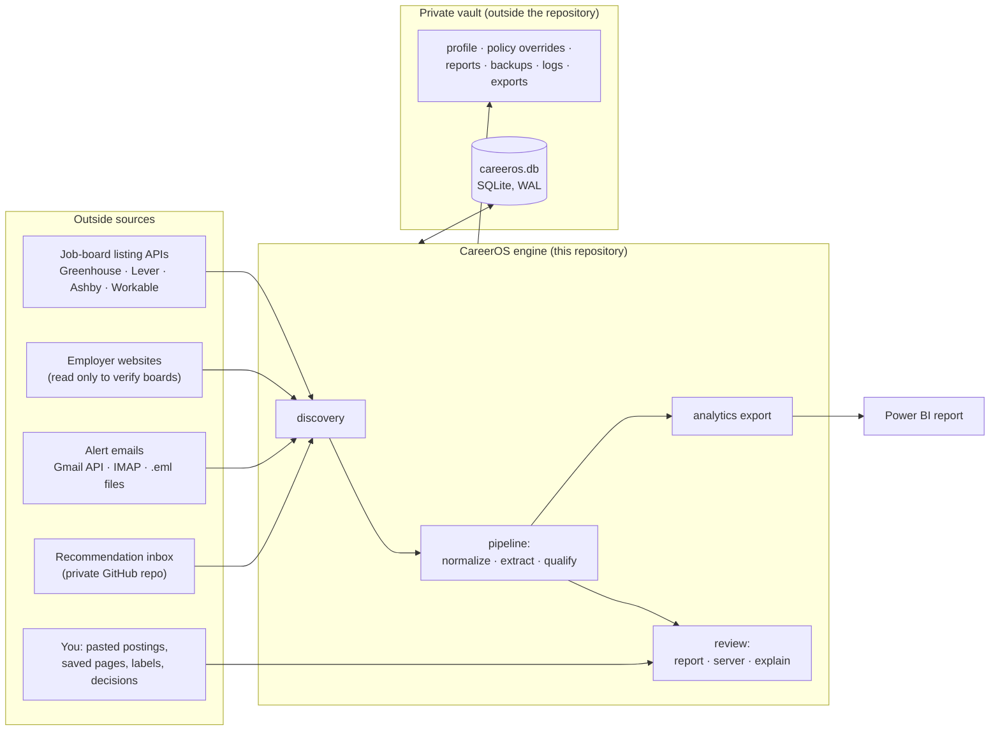
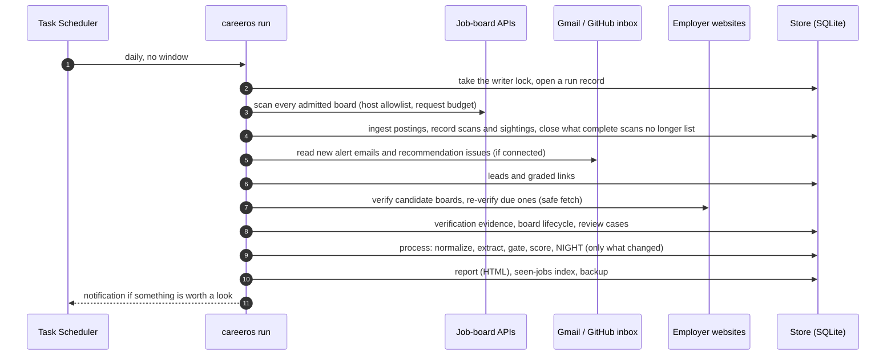
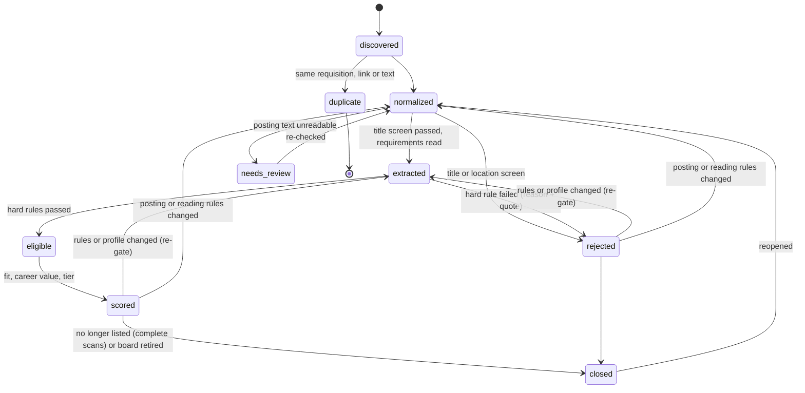
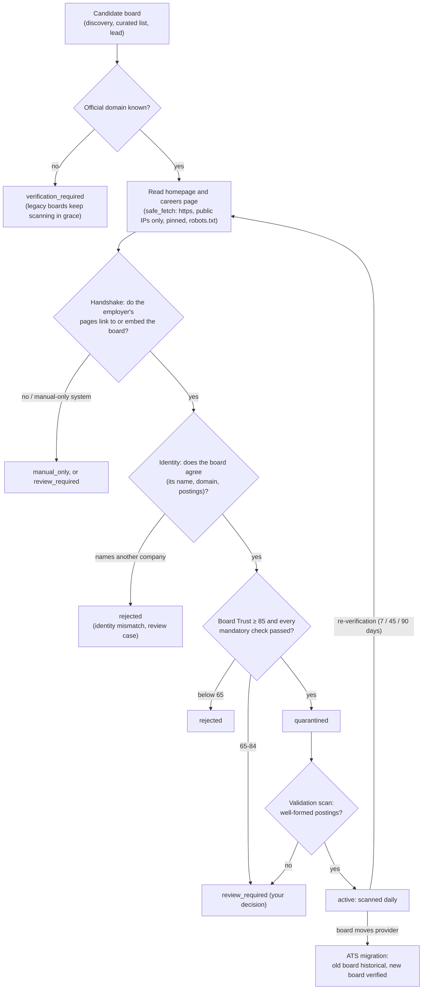
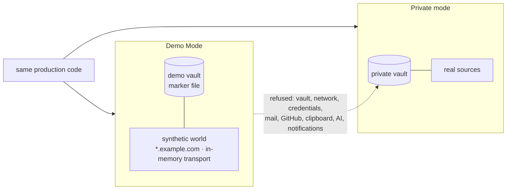
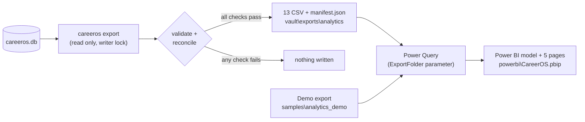

# CareerOS: architecture

- Version: 1.0
- Date: 2026-10-13
- Code: commit `c232196` and later.
- Companions:
  - `security_architecture.md`, `data_lineage.md`, and the decision records in `adr/`;
  - `job_lifecycle.md` (states and transitions in detail);
  - `demo_mode.md`, `analytics_data_dictionary.md`, `business_requirements.md`.

## 1. Overview

CareerOS is a **local, single-user job-search system**. Once a day it:
1. collects postings from employers' public job boards, alert emails and recommendations;
2. checks that each board really belongs to the employer it claims;
3. normalises, deduplicates and screens every posting against the job seeker's hard rules;
4. scores what remains;
5. hands a short, explained list to a person, who decides.

It does not apply, send messages or act on the job seeker's behalf. Automatic applications are deferred to a later
phase, not ruled out (ADR 0007).

| Property | How |
|---|---|
| Local and private | Python 3.12, one SQLite file. Personal data lives in a *vault* folder outside the code repository, and that separation is enforced. |
| Explainable | Every decision is stored with its reasons, its evidence, and the fingerprint of the rules and profile it was made under. `careeros explain JOB` reads it back. |
| Auditable | State changes go only through workflow matrices. History tables are append-only, and the audit log is hash-chained. |
| Conservative with sources | Only four public listing APIs are read automatically. A board is admitted only when the employer's own website points to it. |
| Repeatable | Fixed rules, fingerprints and idempotency keys: processing the same input twice changes nothing. |

## 2. Major components

| Package | Responsibility | Main modules |
|---|---|---|
| `careeros/cli.py` | Commands (`careeros run`, `import`, `review`, `explain`, `export`, `demo`, ...) and the daily run's orchestration | `cmd_run`, `main` |
| `careeros/discovery` | Everything that touches the outside: board scans, alerts, inbox, pasted and saved postings, board discovery and verification, source health | `boards.py`, `http.py`, `safe_fetch.py`, `board_verifier.py`, `board_registry.py`, `board_discovery.py`, `employer_intel.py`, `source_health.py`, `alerts.py`, `gmail.py`, `imap.py`, `github_inbox.py`, `manual_intake.py`, `saved.py`, `seen_index.py` |
| `careeros/normalize` | Posting text and fields: title, location, remote scope, state limits, pay, employment type | `posting.py`, `sanitize.py` |
| `careeros/pipeline.py` + `openings.py` | Ingest, deduplication, sightings, the job workflow, re-evaluation when rules change | `ingest`, `process`, `_reevaluate` |
| `careeros/extract` | Reading requirements: deterministic rules, plus an optional AI reader that must quote the posting | `rules.py`, `ai.py` |
| `careeros/qualify` | Hard rules (the gate), scores and tiers, title rescue, the separate NIGHT profile | `gate.py`, `scores.py`, `facts.py`, `night.py`, `title_rescue.py` |
| `careeros/review` | What a person sees and does: report, local review server, labels, applications, dismissals, explain, metrics | `report.py`, `server.py`, `explain.py`, `applications.py`, `labels.py`, `discovery_metrics.py` |
| `careeros/db` | The store: schema migrations, per-component write permissions, transitions, the audit chain, idempotency receipts | `store.py`, `schema/*.sql` |
| `careeros/core` | Clock, policy and fingerprints, workflow matrices, locks, credential store, redaction | `policy.py`, `transitions.py`, `locks.py`, `credentials.py`, `redact.py` |
| `careeros/ops` | Backups and notifications | `backup.py`, `notify.py` |
| `careeros/demo` | Demo Mode: the sandbox boundary, the synthetic world, demo commands | `sandbox.py`, `world.py`, `runner.py` |
| `careeros/analytics` | The star-schema export for Power BI | `export.py` |
| `config/` | Engine defaults (policy, workflows, site policy) | `policy/defaults.yaml`, `workflows/job.json`, `workflows/application.json`, `site_policy.yaml` |
| `tools/` | Quality gates and builders | `mutate.py`, `mvp_gate.py`, `build_demo_export.py`, `build_powerbi_project.py` |

## 3. The daily run

Task Scheduler starts `careeros run` once a day, without a window. One run holds the single-writer lock from start
to finish.

Each step that reaches outside (scans, mail, inbox, discovery, verification) is isolated. A failure is recorded as an
exception and never stops the run (section 8).

## 4. Job lifecycle

Not drawn: jobs in normalized, extracted, eligible and needs_review can also close.

The transition matrix (`config/workflows/job.json`) is the only way a job's state changes. Each transition writes the
history row, the job's projection and an audit event in one database transaction. `job_lifecycle.md` lists every
transition, its trigger and what it records.

## 5. Verification architecture

A board found anywhere (a lead, research, a guessed name) is only a **candidate**. CareerOS reads the employer's own
website and accepts a board only when the employer itself points to it.

Three separate scores keep three questions apart (ADR 0002):
- **Board Trust**: is this the employer's board? Only verification evidence counts.
- **Board Health**: is it working? It comes from scan outcomes, and outages never touch trust.
- **Career Fit**: is the employer worth scanning often? It comes from the relevant roles seen there, and drives scan
  cadence.

A manual approval can admit a board in the review band, but it expires (90 days by default), and it can never
override a mismatch, an unsafe address or a manual-only system (ADR 0007).

## 6. Data architecture

| Element | Design |
|---|---|
| Store | One SQLite file (`vault\data\careeros.db`) in WAL mode. Schema migrations are `careeros/db/schema/001-012`. |
| Write permissions | Each component gets a `Writer` limited to the tables, and for some tables the columns, it owns (`TABLES_BY_COMPONENT`, `COLUMN_LIMITS`). For example, `qualify` cannot write jobs, `discovery` cannot write scores, and only `admin` may activate a board or record an override. |
| Workflow state | Changes only through `Writer.transition`, which checks the matrix. Projection and history must agree, or the write fails closed. |
| History | Append-only tables (transitions, events, gate results, scores, verification evidence ...), enforced by database triggers. Re-evaluation adds rows and never rewrites them. |
| Audit chain | Every event carries the previous event's hash. `careeros verify` checks the chain and every job's and application's history. |
| Idempotency | Human actions and replays carry receipts keyed by an idempotency key, so a double click never records twice. |
| Fingerprints | Policy (engine defaults merged with private overrides), profile and extraction are fingerprinted, and every decision stores them. A change re-evaluates exactly the affected jobs. |
| Identity | Employers have stable IDs that are never derived from a name. Jobs are keyed `provider:board:posting`. A job's `first_seen_at` is CareerOS's own clock (ADR 0005). |

Vault layout:
- `data\careeros.db`
- `profile\` and `policy\overrides.yaml`: written by the job seeker;
- `policy\private_sites.yaml`: sites, systems and agencies tied to the job seeker's own situation (read by
  `core/private_sites.py`; never in the repository);
- `sources\curated_employers.yaml`
- `inbox\`: saved pages and `.eml` files;
- `reports\`
- `backups\<date>\`
- `logs\`
- `exports\analytics\`

`data_lineage.md` traces each table and key field to its source.

## 7. External integrations

| Integration | Direction | Access | Safeguards |
|---|---|---|---|
| Greenhouse, Lever, Ashby, Workable listing APIs | read | public, no credentials | Host allowlist on every request and redirect, request budgets, politeness pauses, `Retry-After` honoured (a long one is reported, never slept through) |
| Employer websites | read | public | `safe_fetch` (SSRF-safe, pinned connections, robots.txt, size and type caps) and a page budget; used only to verify boards |
| Gmail | read | OAuth `gmail.readonly`, token in Windows Credential Manager | Sender-filtered search; only job links and the text beside them are kept; never marks mail read |
| Gmail over IMAP | read | app password in Windows Credential Manager | EXAMINE (read-only) and `BODY.PEEK` |
| GitHub recommendation inbox | read and write | the `gh` CLI the job seeker signed in | Issue text is data; replies and the published seen-jobs index carry job facts only |
| Anthropic API (optional, off) | write (posting text) | API key in Windows Credential Manager | Public posting text only; every record must quote the posting; falls back to rules |
| Windows notifications | local | PowerShell toast | Text passed through the environment, not the command line |
| Power BI | none (file) | CSV export | Private exports stay in the vault |

Sites that must never be automated (LinkedIn, Indeed, Glassdoor, aggregators, the job seeker's own employer, Workday,
iCIMS ...) are listed in `site_policy.yaml` and `safe_fetch.NEVER_FETCH`. Their links become leads that a person opens.

## 8. Failure handling

| Failure | Handling |
|---|---|
| One board fails (HTTP error, invalid JSON, timeout, rate limit) | Recorded against that board with its own error code. Board health drops; trust does not; other boards carry on. |
| A provider fails broadly | Marked degraded; its failures are held against no employer. |
| A scan returns far fewer postings than usual | `suspicious`: kept, and nothing closed. Only complete scans may close jobs. |
| An email, issue line or job fails to process | Isolated per item and recorded in `exceptions`; the run continues. |
| The run itself fails | The run is marked failed, the traceback goes to the log, and a notification is shown. |
| A second writer starts | Refused by the single-writer lock. A lock left by a crash is an operator hold (`careeros unlock`). |
| A database write disagrees with history | Fails closed: no partial transition. |
| Corruption or mistakes | A daily backup with an integrity check and SHA-256 manifest; 14 kept. |

The Functional MVP gate exercises these failures (`functional_mvp_report.md`).

## 9. Observability

| Signal | Where |
|---|---|
| Run records | `runs` table: status, counts per step |
| Exceptions | `exceptions`: type, severity, code, entity, retryable |
| Board health and scans | `source_scans`, `provider_status`, the report's Sources section, `careeros sources health` |
| Verification evidence | `verification_runs`, `verification_evidence`, `careeros sources explain MAPPING` |
| Decisions | `gate_results`, `scores`, `transitions`, `careeros explain JOB [--json]` |
| Integrity | `careeros verify` (hash chain and histories) |
| Status and metrics | `careeros status`, `careeros metrics`, `careeros funnel` |
| Logs | `vault\logs\careeros.log` (redacted) and `daily-run.log` |
| Analytics | `careeros export` → Power BI, System quality page |

## 10. Human review

People decide; CareerOS prepares. The review points:
- **Labels**: apply, stretch or skip, on the review page or with `careeros label`. They feed agreement measurement.
- **Applications**: you record them, and their status moves only through the application workflow.
- **Board review cases**: the review band, identity mismatches, unreadable sites. You approve with a reason and an
  expiry, reject, or resolve the case.
- **Dismissals** carry a reason. **Title audits** sample title-screen rejections.

What CareerOS never does on its own is set out in ADR 0007.

## 11. Demo and private separation

Demo Mode (`careeros demo ...` or `CAREEROS_DEMO_MODE=true`) runs the same production code on a throwaway demo vault
and a synthetic, offline world. While it is on:
- the private vault cannot be located;
- the real network, credentials, Gmail, GitHub, the clipboard, the AI reader and notifications are refused;
- every outbound client gets the synthetic transport, or fails.

See ADR 0004 and `demo_mode.md`.

## 12. Analytics flow

The schema, its grain and the measures are in `analytics_data_dictionary.md`. The report is described in
`powerbi_dashboard_spec.md`.

## 13. Decisions

| ADR | Decision |
|---|---|
| [0001](adr/0001-official-employer-sites-are-authoritative.md) | The employer's own website decides which job board is theirs |
| [0002](adr/0002-board-trust-health-and-career-fit-are-separate.md) | Board Trust, Board Health and Career Fit are separate scores |
| [0003](adr/0003-new-boards-are-quarantined.md) | New boards are quarantined until a validation scan passes |
| [0004](adr/0004-demo-mode-is-isolated.md) | Demo Mode is isolated from every private source |
| [0005](adr/0005-first-seen-at-belongs-to-careeros.md) | `first_seen_at` is CareerOS's own date |
| [0006](adr/0006-unsupported-ats-systems-stay-manual.md) | Unsupported ATS systems stay manual |
| [0007](adr/0007-human-approval-at-selected-stages.md) | A person decides at selected stages, and CareerOS does not apply or send |
| [0008](adr/0008-local-store-with-enforced-duties-and-audit-chain.md) | One local store, with enforced separation of duties and an audit chain |
