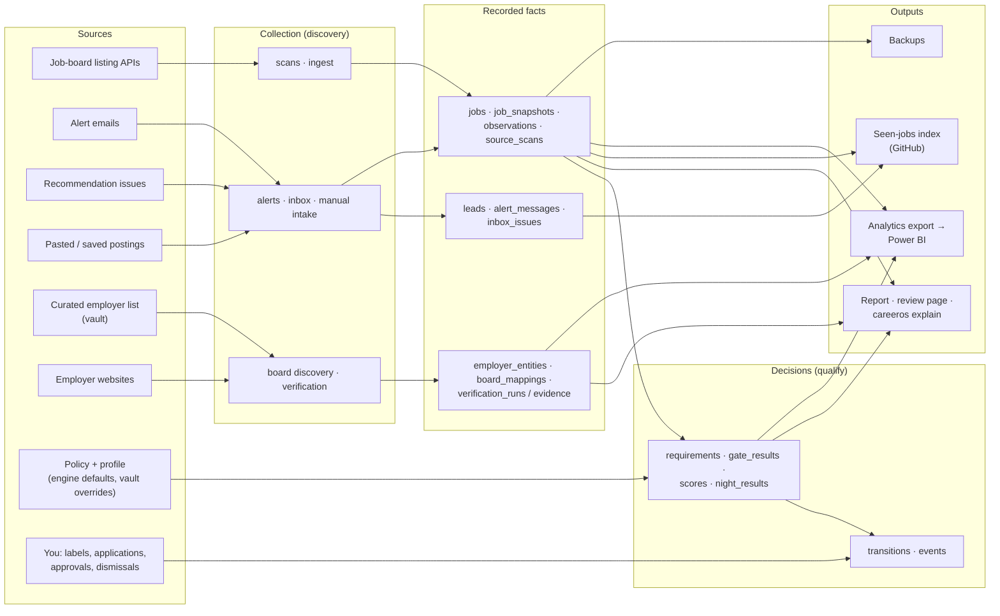

# CareerOS: data lineage

- Version: 1.0
- Date: 2026-10-13
- Companions:
  - `architecture.md`;
  - `analytics_data_dictionary.md` (the export's tables and fields);
  - `job_lifecycle.md`.

Lineage answers four questions for any number CareerOS shows: where it came from, what changed it, which rules it was
made under, and what reads it. This document traces:
- every source to the tables it fills;
- every table to its writer;
- the key fields to their rules;
- the outputs back to the tables.

## 1. End to end

## 2. Sources

| Source | Collected by | Fills | Evidence level |
|---|---|---|---|
| Greenhouse, Lever, Ashby, Workable listing APIs | `discovery/boards.py` via `pipeline.ingest` | `jobs`, `job_snapshots`, `observations` (`ats_scan`), `source_scans`, `provider_status` | `live_ats`: the employer's own board, the strongest |
| Alert emails (Gmail API, IMAP, `.eml` files) | `discovery/alerts.py`, `gmail.py`, `imap.py` | `alert_messages` (which messages were read, never their content), `leads`; links to readable boards become `jobs` with an `alert` sighting | `alert` |
| Recommendation issues (private GitHub repository) | `discovery/github_inbox.py` | `inbox_issues`, `leads`, `jobs`, `observations` (`recommendation`) | `recommendation` |
| Pasted postings and saved pages | `discovery/manual_intake.py`, `saved.py` | `jobs` (`manual:` keys), `observations` (`human_text`, `manual_import`) | `human` |
| Curated employer list (`vault\sources\curated_employers.yaml`) | `discovery/discovery_queue.py`, `board_discovery.py` | `discovery_queue`, `discovery_attempts`, `board_mappings` (as candidates), `lead_matches` | A candidate only |
| Employer websites | `discovery/board_verifier.py` via `safe_fetch.py` | `career_sites`, `verification_runs`, `verification_evidence`, `board_mappings` (lifecycle columns), `board_reviews`, `employer_entities` | Proof of ownership (ADR 0001) |
| Policy and profile | `core/policy.py`, `qualify/profile.py` | Not stored as rows. Their fingerprints are stamped on every decision. | |
| The job seeker | `review/*`, `cli.py` | `labels`, `dismissals`, `applications`, board approvals (`board_mappings` override columns), `board_reviews` resolutions, `title_audit` verdicts | Human |

Weaker sources never overwrite a job's facts. A posting read from the employer's board defines the job; an alert or
recommendation for the same job adds a sighting next to it (`openings.py`).

## 3. Tables

**Writer** is the component allowed to write the table (`db/store.py: TABLES_BY_COMPONENT`).

**Kind:**
- *projection*: current state, rewritten as things change;
- *append-only*: rows are never changed or deleted, enforced by triggers;
- *mutable*: some columns change, but rows are never deleted.

| Table | Writer | Kind | Holds | Read by |
|---|---|---|---|---|
| `jobs` | discovery (facts), extract (fingerprints), transitions (state) | projection | One row per posting: normalised facts, dedupe links, current state | Everything downstream |
| `job_snapshots` | discovery | append-only | The posting text as read, per content version | Extraction, explain |
| `observations` | discovery | append-only | Every sighting with source, evidence level, links, the source's own dates | Dedupe, analytics (`fact_job_observation`) |
| `job_changes` | discovery | append-only | Meaningful edits (what changed) | Re-evaluation, report, explain |
| `opening_links` | discovery | append-only (the store allows no updates) | `same_opening`, `possible_duplicate` and `possible_repost` links | Dedupe, metrics, applications |
| `transitions` | any component, through `Writer.transition` | append-only | Every state change, its reason and trigger | Explain, `verify`, analytics |
| `events` | the store | append-only, hash-chained | The audit log, one event per transition and notable action | `careeros verify` |
| `requirements` | extract | append-only | Requirements read from a posting, with quotes, per extraction fingerprint | Gate, scores, explain |
| `gate_results` | qualify | append-only | Every eligibility decision: hard failures with quotes, flags, and the policy, profile and extraction fingerprints | Scores, explain, analytics |
| `scores` | qualify | append-only | Eligibility, fit, career value, freshness, priority, tier, components and their basis | Report, shortlist, analytics |
| `night_results` | qualify | append-only | The separate NIGHT profile's decisions | NIGHT section, analytics |
| `night_assessments` | qualify | append-only | The first NIGHT design (2026-10-12); superseded by `night_results`, kept for history | — |
| `title_reviews` | discovery | append-only | The budgeted second look at ambiguous titles | Title rescue, metrics |
| `title_audit` | discovery, review | mutable (verdict) | Sampled title-screen rejections and your verdicts | `careeros audit titles` |
| `employers` | discovery, admin | mutable | The boards the daily scan reads (legacy table, linked to board mappings) | Scans |
| `employer_entities` | discovery, admin | mutable | Stable employer records: official domain, career fit, priority | Verification, cadence, analytics |
| `employer_aliases` | admin | append-only (the store allows no updates) | Former and legal names, parents | Employer matching |
| `career_sites` | discovery | mutable | The employer pages a verification read | Verification evidence |
| `board_mappings` | discovery (lifecycle), admin (activation, overrides) | mutable | One row per job board: status, trust, health, activity, provenance, overrides | Scan gate, report, analytics |
| `verification_runs` | discovery, admin | append-only | Each verification, re-verification and validation scan | `sources explain`, analytics |
| `verification_evidence` | discovery, admin | append-only | Each piece of evidence and its trust points | `sources explain` |
| `board_reviews` | discovery, admin | mutable | Cases waiting for you | Report, `careeros sources` |
| `career_fit_history` | discovery | append-only | Every change of an employer's career fit | Explain, trends |
| `source_scans` | discovery | append-only | Every board scan: outcome, size, requests, error | Health, closure, analytics (`fact_board_scan`) |
| `provider_status` | discovery | mutable | Provider-wide degradation | Health, report |
| `discovery_queue` | discovery, admin | mutable | Employers queued for board discovery | Discovery |
| `discovery_attempts` | discovery | append-only | Each attempt to find an employer's board, and its outcome | Metrics |
| `lead_matches` | discovery, review | mutable (audit) | A lead matched to a board posting, and your audit | Lead enrichment, metrics |
| `leads` | discovery, review (status) | mutable | Links CareerOS may not read itself (LinkedIn ...), with title and context | Report, seen index |
| `alert_messages` | discovery | append-only | Which alert emails were read (IDs and counts, not content) | Idempotent mail reading |
| `inbox_issues` | discovery | mutable (closed) | Recommendation issues read and the reply posted | Retries, seen index |
| `labels` | review | append-only | Your Apply / Stretch / Skip labels with the system's tier at the time | Agreement, funnel, analytics |
| `dismissals` | review | append-only | Jobs you dismissed, and why | Shortlist, analytics |
| `applications` | tracker, transitions | projection (no deletes) | Applications you recorded and their current status | Funnel, analytics (`fact_application`) |
| `runs` | runner, discovery, admin | mutable | Each run: status and counts | `status`, observability |
| `exceptions` | any component | mutable (resolution) | Failures to follow up | Report, observability |
| `receipts` | the store | append-only | Idempotency keys of actions already recorded | Replays and double clicks |
| `meta` | admin | mutable | Schema version and settings | Migrations |

## 4. Key fields

| Field | Origin | Rule | Notes |
|---|---|---|---|
| `jobs.first_seen_at` | CareerOS's clock at first ingest | Set once, never changed | The authoritative "when CareerOS learned of it" (ADR 0005) |
| `jobs.last_seen_at` | CareerOS's clock | Moved on every sighting | |
| `jobs.closed_at` | CareerOS's clock | Set only after complete scans miss the job, or when its board is retired | Failed or suspicious scans never close anything |
| `jobs.posted_at`, `source_updated_at` | The employer's API | Copied as stated | Drive freshness and the stale flag. Kept as the employer's claim. |
| `jobs.remote_scope`, `remote_states_json` | Location line and posting text | `normalize/posting.py: remote_scope` | "Remote" alone is never nationwide |
| `jobs.comp_min`, `comp_max`, `comp_period` | Pay text | `normalize/posting.py` | The gate annualises: hour × 2,080, day × 260, week × 52, month × 12 |
| `jobs.family` | Title, then the duties, if the title is ambiguous | Policy `families`, title rescue | Empty = no target family |
| `jobs.duplicate_of`, `variant_of`, `repost_of` | Requisition, link, text and title comparisons | `pipeline._duplicate_of`, `openings.py` | Similar titles never merge on their own |
| `jobs.content_fingerprint` | Posting text | Normalised text hash | A change re-reads the posting |
| `gate_results.policy_fingerprint` / `profile_fingerprint` / `extraction_fingerprint` | Merged policy, profile, reading rules | `core/policy.py`, `pipeline._extraction_fingerprint` | A change re-evaluates the affected jobs. The `operations` settings are excluded. |
| `gate_results.hard_failures_json` | The gate | `qualify/gate.py` | Each failure has a code, a plain explanation and, where possible, the posting's own words |
| `scores.apply_priority`, `tier` | Fit, career value, freshness | `qualify/scores.py`: 0.65 / 0.25 / 0.10; tiers at 92 / 85 / 78, A and B need ELIGIBLE and ≥ 70% skills | Weights and thresholds come from the policy |
| `board_mappings.board_trust_score` | Verification evidence | `board_verifier.py`: handshake 40, identity 20, second link 15, function 10, domain 10, agreement 5 | Legitimacy only (ADR 0002) |
| `board_mappings.board_health_score` | The last 10 scans outside outages | `source_health.py` | Operations only |
| `employer_entities.career_fit_score`, `career_priority` | Relevant roles seen, by CareerOS's dates | `employer_intel.py` | Drives scan cadence |
| `applications.current_state` | You | Application workflow (`config/workflows/application.json`) | |

## 5. Outputs

| Output | Built from | Where |
|---|---|---|
| Daily report and review page | `jobs`, `scores`, `gate_results`, `leads`, `board_mappings`, `board_reviews`, `source_scans`, `applications` | `vault\reports\report-<date>.html`, `careeros review` |
| `careeros explain JOB` | `jobs`, `observations`, `transitions`, `gate_results`, `scores`, `night_results`, `labels`, `applications` | Terminal or JSON |
| Seen-jobs index | `jobs`, `observations`, `leads`. Job facts only (company, title, location, requisition, links, first and last seen, source); never labels, decisions, scores or pay. | `vault\reports\inbox-index`, published to the private inbox repository |
| Analytics export | The tables mapped in `analytics_data_dictionary.md` (each fact's source is named there) | `vault\exports\analytics` → Power BI |
| Backups | `careeros.db`, profile, policy overrides | `vault\backups\<date>` |

## 6. Retention

- **History is kept.** Append-only tables are never trimmed. Jobs, boards and applications are never deleted: closed,
  historical and retired rows stay, with their history.
- **Backups:** the newest 14 dated backups are kept. Only folders the backup itself created are ever pruned.
- **Exports** are replaced as a whole on each `careeros export`.
- **Demo vaults** are deleted only with `careeros demo reset`, and only when they carry the demo marker.
- **Email content is not stored**: only the alert's sender, subject, links and the text beside each link.

## 7. Identifiers

| Identifier | Form | Stable? |
|---|---|---|
| Job | `provider:board:posting` (for example `greenhouse:meridianrx:101`), or `manual:<employer>:<hash>` | Yes |
| Board | `provider:token`, or the host of a manual-only system | Yes |
| Employer | `ent:<random>` inside the database; the normalised name in the analytics export | Inside the database only |
| Runs, scans, cases, events, applications | `<kind>:<random>` | No. They are never exported. |
| Analytics keys | Natural keys, or sequences in recording order | Yes: the same database gives byte-identical exports |
