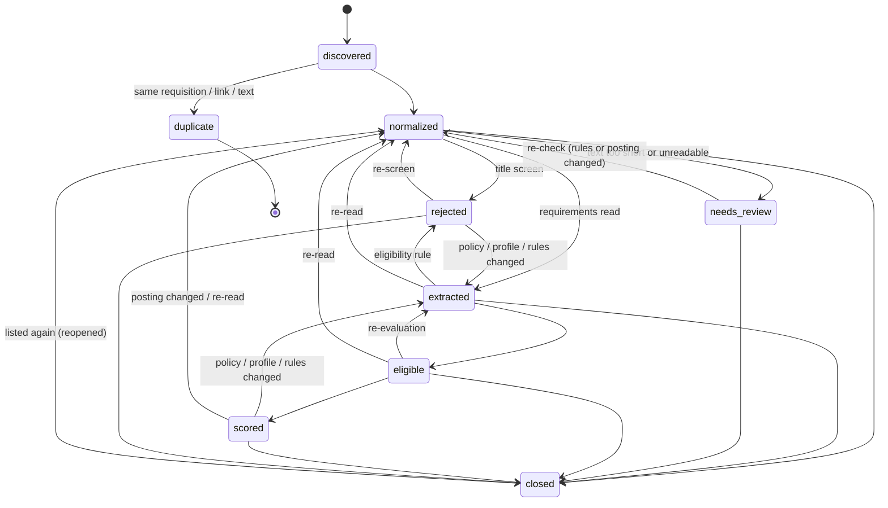

# CareerOS: the job lifecycle

- Version: 1.0
- Date: 2026-10-13
- Companion to `business_requirements.md` and `requirements_traceability.md`.

This document follows one job posting from the moment CareerOS first sees it to the analytics it feeds. It covers:
- the states a job can be in;
- what moves it between them;
- which decision is recorded at each step;
- how any job can be made to explain itself.

It reflects the code as built (`careeros/pipeline.py`, `config/workflows/job.json`) and the audit made for Portfolio
Prompt 4.

## 1. The stages

| # | Stage | What happens | Code | What is recorded |
|---|---|---|---|---|
| 1 | Source | A posting arrives from an employer's job board (public listing API), an alert email, a recommendation, a saved page or pasted text. | `discovery/boards.py`, `alerts.py`, `github_inbox.py`, `saved.py`, `manual_intake.py` | `leads` (links CareerOS may not read itself), `observations` (every sighting) |
| 2 | Ingest | The posting becomes a job, keyed `ats:board:posting-id`. | `pipeline.ingest` | `jobs` row, `job_snapshots` |
| 3 | Normalize | Title, location, remote scope and state limits, country, employment type, pay (annualised), deadline, family. | `normalize/posting.py`, `pipeline.normalized_fields` | `jobs` columns, content fingerprint |
| 4 | Identify employer | The job belongs to the employers row (board) it came from; the board belongs to a stable employer record. | `discovery/board_registry.py` | `employers.entity_id`, `employer_entities` |
| 5 | Verify | Is the board the employer's own (official-site handshake, identity, trust)? Unverified boards are not scanned, except legacy boards during their grace. | `discovery/board_verifier.py` | `board_mappings`, `verification_runs`, `verification_evidence` |
| 6 | Deduplicate | Same requisition, link or text = duplicate; same requisition elsewhere or same title with other text = variant; same title, different requisition = linked, never merged. | `pipeline._duplicate_of`, `openings.py` | `duplicate_of`, `variant_of`, `repost_of`, `opening_links` |
| 7 | Eligibility | Title screen (family, excluded titles, remote / country), then requirement reading and the eligibility rules. | `pipeline._title_screen`, `_extract_one`, `_gate_one`, `qualify/gate.py` | `gate_results` (every decision, with reasons, quotes and the fingerprints it was made under), `requirements` |
| 8 | Fit | Weighted skill coverage, experience, seniority, education. | `qualify/scores.py` | `scores.candidate_fit`, `components_json` |
| 9 | Career value | Pay against your target, progression, domain, stability. | `qualify/scores.py` | `scores.career_value` |
| 10 | Route | A, B, near-miss or archive (A / B need an eligible state and minimum coverage); conditional / held states; the separate NIGHT profile. | `qualify/scores.py`, `qualify/night.py` | `scores.tier`, `scores.state`, `night_results` |
| 11 | Action | You label (Apply / Stretch / Skip), dismiss with a reason, draft, or apply. | `review/*` | `labels`, `dismissals`, `applications` |
| 12 | Status | The application moves through its own workflow (`config/workflows/application.json`). | `review/applications.py` | application transitions |
| 13 | Outcome | Responded, screening, interviews, offer, accepted / declined, rejected, withdrawn, ghosted. | same | application state |
| 14 | Analytics | Funnel by source, metrics, label agreement. | `review/funnel.py`, `discovery_metrics.py`, `labels.py` | derived (read-only) |

## 2. The job state machine

| State | Meaning | Entered by | Left by |
|---|---|---|---|
| discovered | just ingested | ingest | immediately: to normalized, or to duplicate (same transaction) |
| normalized | fields extracted; waiting for screening | ingest; any re-check | the next processing step (title screen, extraction, review) |
| needs_review | the posting cannot be judged reliably (too little text, too few readable requirements) | extraction | a rule / policy / profile change, a posting change, or closure |
| extracted | requirements read | extraction; re-evaluation | the eligibility rules |
| eligible | passed every hard rule | the rules | scoring |
| scored | scored and routed (the normal end state of an open job) | scoring | re-evaluation, a posting change, or closure |
| rejected | failed the title screen or a hard rule, with a recorded reason | screen / rules | re-evaluation, re-screen, or closure |
| duplicate | the same opening as another job (terminal) | ingest | never (the original carries the history) |
| closed | no longer listed (2 complete scans without it), its board retired or rejected, or confirmed removed | ingest, `close_open_jobs`, shortlist refresh | reappearing on a complete scan (reopened) |

**Every transition** is checked against the workflow matrix. It writes a transition record and a hash-chained audit
event in the same database transaction. Forward steps (normalized → extracted → eligible → scored) need no reason. Rejections, reviews, duplicates, closures and
every backward move must carry one. A job
whose current state disagrees with its history fails closed.

## 3. Repeat processing (idempotency)

| Repeated action | Result |
|---|---|
| `process` with nothing new | Nothing changes: no transition, decision, score, NIGHT result or event. Each decision is keyed by the policy, profile and extraction fingerprints it was made under. |
| The same postings scanned again | Only `last_seen_at` moves. Content is compared by fingerprint, so an unchanged posting is not re-read, re-judged or re-recorded. |
| The same alert email or recommendation | Recognised by message / issue identity and canonical link. Never a second lead or job. |
| A double click (label, application, status change) | Recorded once (idempotency receipts); a different payload under the same key is refused. |
| `careeros explain` | Read-only. |
| A policy, profile or rule-code change | **Intended** re-evaluation: every affected job goes back through screening and the rules once. Old decisions are kept as history. |

## 4. Audit findings (Prompt 4) and what was done

| Finding | Kind | Fix |
|---|---|---|
| Jobs parked in `needs_review` were skipped by re-evaluation: a policy, profile or rule change never re-checked them, so they could stay parked indefinitely. | stuck jobs | A review outcome is now recorded as a decision (a `gate_results` row with `needs_review` and the fingerprints), and re-evaluation includes it. Jobs parked before this change are re-checked once (`review_rechecked`). |
| Four allowed transitions could never happen in code: discovered→closed, extracted→needs_review, needs_review→extracted, normalized→duplicate. | dead paths | Removed from the workflow matrix. A test pins the matrix. |
| Retiring a board after an ATS move skipped any job that failed to close without a word. | silent exception | One shared `close_open_jobs` records every failure as an exception. |
| Rejecting a board left its open jobs open; they had to be closed by hand. | inconsistent state | `careeros sources reject` now closes the board's open jobs (history kept), through the same `close_open_jobs`. |
| "Relevant role" was defined twice, slightly differently (discovery counted managers; career fit ignored excluded titles). | duplicate logic | One `relevant_role` rule, used by both. |
| A rejection for pay below the floor carried no quote from the posting. | missing evidence | The rejection quotes the posting's pay line, or the board's own pay fields. The rules version was bumped, so existing pay rejections are re-judged with their evidence. |
| No single place answered "why is this job where it is?" | explainability | `careeros explain JOB` (below). On a copy of the live database, every job explains completely. |

**Checked and found consistent** on the live data (2026-10-13):
- No job is waiting in a transient state after a run.
- Every rejection has a recorded reason; every scored job has a score.
- Every duplicate points at an existing original.
- `closed_at` agrees with the state.
- No job has repeated exceptions.

## 5. Known limitations (by design, documented)
- **Jobs from a paused board stay open.** Their board is not scanned, so they are not closed by absence. Their
  explanation shows the board as paused. A paused board is often a temporary condition; retiring or rejecting the
  board closes them.
- **Jobs from a single link or pasted text are never closed automatically.** No board scan covers them. Shortlisted
  Greenhouse / Lever jobs are re-checked individually. Others rely on the stale flag and your dismissal.
- **Re-evaluation is deliberately broad.** Any policy or rule change re-checks every affected job, which is the main
  source of audit-event volume, which can be large. Operational settings never trigger it.

## 6. Every job explains itself: `careeros explain JOB [--json]`

| Question | Answered from |
|---|---|
| source | the job's source and system, its board, its link, every sighting (`observations`) and every lead pointing at it |
| first_seen_at | CareerOS's own first sighting, next to the employer's posted / updated dates |
| last_seen_at | the last sighting, the closure time, and the missed complete scans |
| employer | the employer name and parent, the employer record and its official domain |
| verification | the board's status, provenance, handshake, identity, Board Trust and Health, the employer's Career Fit, and whether / why it is scanned; "not applicable" for single-link and pasted jobs |
| duplicate_decision | duplicate (of what, why), or a distinct opening with its variant / repost / related links |
| eligibility | the latest decision and its stage (title screen, rules, review), hard failures with quotes, flags, eligibility facts |
| fit | candidate fit, the eligibility score and state, and their components (or why there is none) |
| career_value | the career-value score and components (or why there is none) |
| routing | the tier, apply priority, interview band and stretch flag, plus the overnight (NIGHT) result |
| status | the current state, since when, and the recent history with reasons |
| rejection_reason | the first hard failure with its quote; "duplicate of …"; or "not applicable" |
| review_reason | why it is parked for review, or the flags and the unknowns to check before applying |
| actions | labels, dismissals, applications with their outcome, and the next action |

A question that does not apply says so and why ("not applicable: …"), so an explanation is never silently
incomplete. The explanation reads recorded decisions only; it recomputes nothing.
