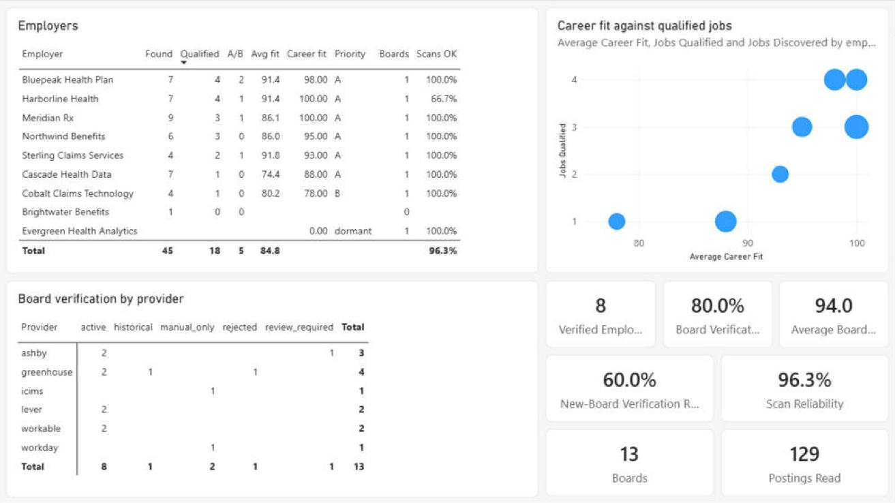

# CareerOS: portfolio overview

- Version: 1.0
- Date: 2026-10-29
- For: hiring managers and interviewers for business systems analyst, automation analyst and process improvement
  analyst roles.
- Voice: "I" means Christopher Little, the owner. Claude drafted this page from the project's records.
- Companions: the [README](../README.md), the [case study](case_study.md) and
  [AI-assisted development](ai_assisted_development.md).

## Summary

CareerOS is a job-search decision-support system that I conceived and directed as product owner and business
systems analyst, for my own job search. It treats the search as an operations problem. Each day it collects openings from
public job-board listings and alert emails, checks that each job board belongs to the employer, catches duplicates,
rejects jobs that fail a stated hard requirement, scores the rest and records the reason for every decision. A person
reviews the result and decides; CareerOS has no code that applies for a job or contacts an employer or recruiter.

Claude, an AI coding assistant, wrote the code under my direction and my acceptance rules; ChatGPT helped design it. I
had the result checked against my own judgement: I labelled 50 real postings and Claude compared CareerOS's decisions
with them. The hard rules agreed with my 50 labels (in-sample); the ranking did not yet. That gap is written up below
as a continuous-improvement case.

## My role

I was the product owner and business systems analyst. In short:
- **Problem and goal.** I came up with the idea and defined the problem and the goal: fewer, better-qualified
  openings, each with its reasons, rather than more applications (quality over volume).
- **Rules and requirements.** I supplied my own facts and personal rules (my profile, the pay floor, the location rule
  and which job titles count) and approved the rest of the screening rules. I supplied or approved the requirements:
  ChatGPT drafted the main specifications, and I chose which were built and decided their open questions. My own
  values stay in a private vault; the public demo uses a fictional job seeker.
- **Acceptance.** I set the acceptance rule for every milestone (tests passing, regressions fixed, a written report,
  open issues listed) and approved the two MVP gates.
- **Decisions.** I made the decisions put to me, and overrode the AI where I disagreed: twice on tier rules (a
  skill-coverage minimum for the top tiers; a second, broader tier of job titles my experience counts for), and once
  on publication, waiting for a sanitized public snapshot instead of a private copy of the repository for CI.
- **Evaluation.** I judged the work by using it: running its commands, labelling 50 real postings, live-testing the
  recommendation hand-off, and sending work back when behaviour did not match what I intended. I did not review the
  code line by line.
- **Privacy and release.** I set the privacy requirements, approved the MIT licence, and approved publication.

Claude, an AI coding assistant (Anthropic, working through Claude Code), wrote nearly all of the code and tests,
drafted most of the documentation, including the requirements catalogue and the decision records, and wrote the
script that generates the Power BI report files. ChatGPT (OpenAI) helped design it, as the design and analysis
partner. The full account, with its limits, is in [AI-assisted development](ai_assisted_development.md).

## Skills and the evidence

Each row names the skill, my part in it, and where to check it. File names in code font are paths from the
repository root.

### Business systems analyst

| Skill | My part | Where to look | What it shows |
|---|---|---|---|
| Problem framing and business case | Defined the problem and the goal | [README](../README.md#business-problem), Business problem and Solution; [case study](case_study.md), sections 1-2 | Seven concrete pain points turned into five design principles |
| Requirements | Supplied or approved the requirements. Claude consolidated them from ChatGPT's specifications and the built system | [business requirements](business_requirements.md): business problems BP-1 to BP-9, stakeholders, 101 requirements and 12 acceptance criteria | Numbered, stable requirement IDs grouped by type (functional, data quality, security, privacy, audit and more) |
| Traceability | Approved the documentation milestone | [traceability](requirements_traceability.md), for example the rows for FR-032 (board verification), FR-021 (duplicates) and FR-074 (explain any job) | Each requirement traced to the code and the tests; many rows also name a demo step |
| Business rules and decision logic | Supplied my own facts and personal rules (profile, pay floor, location rule, which job titles count) and approved the rest of the screening rules; overrode the AI on the tier skill minimum and the experience titles | `config/policy/defaults.yaml` (public defaults); [architecture](architecture.md), section 5 (verification decision flow); [AI-assisted development](ai_assisted_development.md), section 6 | Rules held as configuration, with the decision flow for admitting a job board |
| Acceptance criteria and stage gates | Set the milestone rule and approved the two MVP gates | [Functional MVP report](functional_mvp_report.md); [Portfolio MVP report](portfolio_mvp_report.md) | Each requirement graded PASS, PARTIAL or FAIL, with gaps listed. Both reports are Claude's self-assessments |
| Decision records | Made the decisions put to me; accepted or sent back the rest at milestones | [ADR index](adr/README.md) | Eight decisions, each with context, alternatives considered and evidence |

### Automation analyst

| Skill | My part | Where to look | What it shows |
|---|---|---|---|
| End-to-end automated process | Chose which milestones were built and in what order; approved the daily scheduling | [README](../README.md#workflow), Workflow; [architecture](architecture.md), section 3 (daily-run sequence diagram) | A scheduled daily run under a single-writer lock that processes only what changed |
| Exception handling | Sent work back when observed behaviour did not match the intent | [architecture](architecture.md), section 8 | A failure in one board, email or job is recorded and never stops the run |
| Repeatable processing | Set the acceptance rules the gates check | [Functional MVP report](functional_mvp_report.md) (repeat processing) | Reprocessing changes nothing; two demo tours give the same result |
| Controls on automation | Approved installs, downloads and publishing; new collection features were switched on only at my instruction | [security architecture](security_architecture.md); [ADR 0007](adr/0007-human-approval-at-selected-stages.md) | An allowlist of job-board hosts, sites that are never automated, and a person before anything reaches an employer or recruiter; other outward actions only under the owner's explicit authorization |
| One-command validation and CI | Required development tools to be verified safe before installation | `tools/validate.py`; `.github/workflows/ci.yml` | The same checks run locally and in CI on Windows and Linux |

### Process improvement analyst

| Skill | My part | Where to look | What it shows |
|---|---|---|---|
| Defining the measure | Set the goal (quality over volume) and labelled 50 real postings | [case study](case_study.md#ranking-calibration-identify-measure-improve-validate), ranking calibration | The measure is agreement with the job seeker's own Apply, Stretch and Skip labels |
| Measurement and analysis | Supplied the labels; the analysis was Claude's, for my decision | The same section | Where the process agreed with the labels (hard rules, in-sample) and where it did not (ranking) |
| Error-proofing | Accepted the controls through the milestone process | [README](../README.md#employer-verification), Employer verification; [case study](case_study.md), "Defects the controls caught" | Impostor job boards rejected, duplicates caught by requisition number, defects caught by controls rather than by chance |
| Quality of the checks themselves | Set the milestone rule; once held a commit until the full test-of-the-tests run (planted defects) had finished | [README](../README.md#testing), Testing; `evidence/mutation-receipt.json` | Planted defects show the tests catch each of 305 deliberately broken rules |
| KPIs and reporting | Approved the milestone that built them. Claude wrote the export and the report generator | [data dictionary](analytics_data_dictionary.md); [dashboard spec](powerbi_dashboard_spec.md) | A validated star schema whose figures reconcile with the application before anything is written |

## Two-minute tour

Demo Mode runs on fictional employers, offline, with no credentials. Every number below is **synthetic**. Set it up as
in the README's [quickstart](../README.md#quickstart): run `careeros demo tour` once, then turn Demo Mode on
(`set CAREEROS_DEMO_MODE=true`). The expected lines come from the [reviewer walkthrough](demo_walkthrough.md), whose
excerpts a test checks against the real commands.

| Command | What you'll see | What it shows |
|---|---|---|
| None: the README's top and the Executive Overview screenshot | On synthetic data, 45 postings come in, 18 qualify (27 pass the hard rules and are scored; 18 of those reach a review tier) and 5 are recommended; every rejection has a reason | Problem framing and KPI design |
| `careeros status` | `jobs: scored=27, rejected=13, closed=4, duplicate=1` | End-to-end automation and deterministic processing: four simulated days of the real daily run, with totals the tests pin |
| `careeros sources explain greenhouse:quillon` | `status=rejected`, `identity=mismatch`, `board names another company: Quillon Logistics` | Requirement to rule to evidence (FR-032): a board is admitted only when the employer's own website links to it and the board agrees who it belongs to |
| `careeros explain greenhouse:meridianrx:102` | `decision: duplicate`, `of: greenhouse:meridianrx:101`, `reason: same_requisition` | Data quality (FR-021): one opening arriving through several channels is recorded once and cannot be applied to twice |
| `careeros explain greenhouse:meridianrx:101`, the ROUTING lines | `tier: near_miss`, `apply_priority: 80.7` | Explainability and audit trail (FR-074): every job answers the same 14 questions from recorded decisions, and a fact the posting does not state is a flag, never a match |

Then, by role:
- **Business systems analyst:** the [traceability](requirements_traceability.md) rows for FR-032, FR-021 and FR-074:
  each requirement traced to code and tests, and each of these three also names its demo step.
- **Automation analyst:** the [architecture](architecture.md) section 3 sequence diagram, then `careeros verify`
  (expected: `"event_chain_breaks": []`): a scheduled daily run under a single-writer lock, where a failure in one
  item never stops the run, reprocessing changes nothing, and one command runs the same checks as CI.
- **Process improvement analyst:** the Executive Overview screenshot, where the synthetic rejections fall into a few
  reasons (title 6, location 3, pay 3, safety 1). On real data, the measure that matters is agreement with my own
  labels: see the [ranking calibration](#ranking-calibration-identify-measure-improve-validate).

## Best visuals

1. **The Executive Overview** (`powerbi/screenshots/executive.png`): KPI cards, the funnel from discovery to
   application, and why jobs are rejected. Points to explain: some card titles are cut off; "Duplicates Prevented 3"
   counts duplicate jobs plus linked openings, so it differs from the one duplicate job in `careeros status`; and the
   "Applied" bar counts applications the fictional job seeker recorded, because CareerOS submits nothing.

   

2. **The per-job workflow diagram** in the [README](../README.md#workflow): source to person in one line.
3. **Every decision explains itself**, Demo Mode output:

   ```
   > careeros sources explain greenhouse:quillon
   status=rejected
   identity=mismatch
   board names another company: Quillon Logistics

   > careeros explain greenhouse:meridianrx:102
   decision: duplicate
   of: greenhouse:meridianrx:101
   reason: same_requisition
   ```

4. **Employer Intelligence** (`powerbi/screenshots/employers.png`): the board-verification matrix (8 active, 1
   historical after an ATS migration, 2 manual-only, 1 rejected as an impostor, 1 awaiting review).

   

5. **For a deeper look:** the [architecture](architecture.md) section 5 verification flowchart (business rules as a
   decision tree) and section 3 sequence diagram (the automated daily run).

About the Power BI report: its files are generated from the validated analytics export by
`tools/build_powerbi_project.py`, a script Claude wrote, and a Claude session captured the screenshots. All five pages
carry cosmetic issues (cut-off card titles, raw field names in subtitles, one table that scrolls sideways), and the
Job Pipeline page's response and interview rates are synthetic, not results of my job search.

## Where to find things

| Looking for | Where |
|---|---|
| Requirements | [business requirements](business_requirements.md) and [traceability](requirements_traceability.md) |
| Decision records | [ADR index](adr/README.md); the decisions I made, including overrides, in [AI-assisted development](ai_assisted_development.md), sections 2 and 6 |
| Testing evidence | The README's [Testing](../README.md#testing) section; `evidence/functional_mvp.json` and `evidence/mutation-receipt.json`; the [Functional MVP](functional_mvp_report.md) and [Portfolio MVP](portfolio_mvp_report.md) reports; the CI workflow `.github/workflows/ci.yml` |
| Security and privacy | [security architecture](security_architecture.md), [SECURITY.md](../SECURITY.md), [PRIVACY.md](../PRIVACY.md) |
| Limitations | The README's [Limitations](../README.md#limitations); the case study's "Not yet measured"; [AI-assisted development](ai_assisted_development.md), section 7 |
| A hands-on tour | The [reviewer walkthrough](demo_walkthrough.md) and [Demo Mode](demo_mode.md) |

## Ranking calibration: identify, measure, improve, validate

This is the project's continuous-improvement case.

| Step | Status | What happened |
|---|---|---|
| Identify | Done | The question: do CareerOS's hard rules and tiers agree with my own Apply, Stretch and Skip labels? |
| Measure | Done, once (2026-10-16) | I labelled 50 real postings (22 Apply, 11 Stretch, 17 Skip); Claude compared them, read-only, with the decisions of the code published here, on my private system |
| Improve | Not done | A candidate rule exists as a hypothesis only; nothing in this repository has changed |
| Validate | Not done | No change has been checked on labels given after it was chosen |

The hard rules agreed with my 50 labels (in-sample), but none of the 22 Apply jobs reached the top tiers (A/B), and
the scored Apply and Skip jobs had the same average priority to one decimal place (70.3). The requirement-match
measures, which are not part of the priority, did separate the two groups (mean eligibility score 86.0 against 67.7).
Career value, a quarter of the priority, averaged slightly higher for the Skip jobs (84.6 against 81.9). The full
write-up, with its limits, is in the [case study](case_study.md#ranking-calibration-identify-measure-improve-validate).
