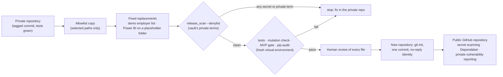

# CareerOS: public release strategy and checklist

- Version: 1.0
- Date: 2026-10-13
- Reviewed: commit `d9453c8` (17 commits, 236 files, 163 earlier file versions), plus this change.
- Tools:
  - `tools/release_scan.py`: never prints a matched value;
  - a private denylist of 14 terms, kept outside the repository and reported by number only.
- Scope: written in the private development repository, so "this repository" means that one. The public repository
  is the snapshot this document describes how to generate.

## 1. Recommendation

**Do not make this repository public.** Build the portfolio as a **new public repository generated from selected
components** (option 2):
- with a fresh Git history (one initial commit);
- after a preparatory refactor that moves every personal specific out of code and tests and into the private vault
  (done on 2026-10-14: refactor R4, below).

The private repository stays private and keeps its history.

| Option | Verdict | Why |
|---|---|---|
| 1. Sanitised copy of this repository (rewrite or squash its history, then delete what is private) | Rejected | Every one of the 17 commits carries the author's name and personal email, and earlier file versions repeat the personal findings below. History rewriting is easy to get wrong. Delete-what-is-private is deny-by-default in reverse: anything missed ships. |
| **2. Generated public repository from selected components** | **Recommended** | An **allowlist** decides what ships, so anything not chosen stays private. A generator applies a few fixed replacements (demo employer list, Power BI on a placeholder folder). A scan with the private denylist must come back clean, and the full test suite must pass inside the snapshot. The history starts empty, under a GitHub no-reply identity. |
| 3. Other: publish only docs and screenshots, or a code-less template | Rejected as the main artifact | It would not show working code, tests and quality gates, which is the point of the portfolio. Useful only as a fallback. |

**Preparatory refactor, before the first snapshot.** Before it, the code and tests named personal settings: employer and
agency names, an excluded employer, the real pay floor and the private inbox repository (section 3). Moving those
specifics into the vault's private overrides keeps the shared code identical in both repositories, so the generator
needs almost no rewriting rules. That is safer, because nothing important depends on a find-and-replace.

## 2. The release pipeline

Only the snapshot's manifest (source commit and file hashes) is recorded, and it stays in the private repository.

**What the public repository contains:**

| Path | In the public repository |
|---|---|
| `careeros/` | Yes, after the preparatory refactor |
| `tests/` | Yes, after the preparatory refactor (fictional names and figures) |
| `tools/` | Yes |
| `config/workflows/`, `config/policy/defaults.yaml` | Yes, generic after the refactor |
| `config/site_policy.yaml` | Yes, with the four supported providers and the generic never-automate list; personal entries move to the private overrides |
| `config/employers.yaml` | Replaced by the fictional demo list (the real list is 33 employers the job seeker follows) |
| `docs/` | Yes, after replacing the few mentions of real employers from the private search (two documents) |
| `samples/analytics_demo/` | Yes (synthetic) |
| `powerbi/` | The project with a neutral `ExportFolder`; the `.pbix` is left out (it stores the folder path; the owner's decision, 2026-10-14). Screenshots: yes (demo data, reviewed). |
| `evidence/` | Regenerated in the snapshot, not copied |
| `README.md` | Yes: the project overview, written for publication on 2026-10-13 (Prompt 11). It is scanned with the denylist like every other file. |
| `docs/operator_manual.md` | Never: the job seeker's operator manual (it was the README until 2026-10-13) |
| `SECURITY.md`, `PRIVACY.md`, `.gitignore`, `.env.example`, `LICENSE` | Yes (choose a licence) |
| The vault, `.venv`, Git history, private notes outside the repository | Never |

## 3. Findings of the 2026-10-13 scan

Types and files only; no values are reproduced here. "Denylist" is a term from the private list kept outside the
repository.

| Finding type | Where (current files) | Only in Git history | Release action |
|---|---|---|---|
| Real secrets (API keys, OAuth tokens, GitHub tokens, cookies, passwords, private keys) | **None** | **None** | None |
| Credential-like test placeholders | `tests/test_demo_mode.py` (62), `tests/test_gmail.py` (25), `tests/test_imap.py` (30): all fake, now marked `release-scan: fake` | Earlier versions of `tests/test_demo_mode.py` (the same fake sentinel) | None; history is not published |
| The job seeker's name or email in files | **None** | None | None |
| Name and email in commit metadata | — | All 17 commits | Fresh history with a GitHub no-reply identity |
| Phone numbers | None (one fictional 555 number in a redaction test) | None | None |
| Recruiter information, real applications, OAuth data, cookies | None | None | None |
| User name in machine-specific paths | `docs/operator_manual.md` (15; moved from `README.md` on 2026-10-13), `powerbi/CareerOS.SemanticModel/model.bim` (the `ExportFolder` parameter) | Earlier READMEs | The operator manual is never published; Power BI regenerated with a placeholder folder |
| Employer and agency names from the private settings (denylist 5-9) | Code: `discovery/safe_fetch.py`, `alerts.py`, `saved.py`, `board_urls.py`, `board_discovery.py`, `cli.py`, `review/report.py`, `review/server.py`. Config: `policy/defaults.yaml`, `site_policy.yaml`. Tests: `test_alerts`, `test_applications`, `test_board_verification`, `test_gmail`, `test_saved`, `test_v22_primary`, `test_v25_audit`, `fixtures/synthetic_overrides.yaml`. Also `docs/operator_manual.md` (formerly `README.md`), `evidence/mutation-receipt.json`, `tools/mutate.py`. | Earlier versions of the same files | Preparatory refactor: personal entries move to the private overrides; tests use fictional employers |
| An excluded employer (denylist 10) | `tests/test_v25_audit.py` | Same | A fictional name |
| The real pay floor (denylist 11-13) | `docs/operator_manual.md`, `tests/test_github_inbox.py`, `test_job_lifecycle.py`, `test_v25_audit.py`, `test_v26_discovery.py` | Same | Demo figures in tests |
| Private inbox repository name (denylist 14) | `tests/test_github_inbox.py`, `test_v21_policy.py`, `test_v25_audit.py` | Same | An example repository name |
| The real employer list (search targets) | `config/employers.yaml` (33 employers). One of them is also named in `tests/test_core.py`, `tests/test_v25_audit.py`, `docs/adr/0001-*`, `docs/analytics_data_dictionary.md`. | Same | Demo list; generic wording |
| Database dumps or backups | **None** | **None** | None |
| Screenshots and Power BI files | `powerbi/screenshots/*.png` (5), `powerbi/CareerOS.pbix` | — | Demo data only; reviewed. Re-save the `.pbix` from the placeholder build. |
| Real test fixtures | None: `tests/fixtures/` holds synthetic profile and policy files; tests build synthetic jobs | None | None |

**Status 2026-10-14 (refactor R4):** the personal entries above have left the code, configuration and tests (section 4).
The findings remain in this repository's Git history, which is never published.

**Conclusion:** no secret has ever been committed. What is private is **personal operating detail**:
- the job seeker's identity in commit metadata and paths;
- the employment situation;
- the real pay floor and an excluded employer;
- the employers being followed.

It is spread through code, tests, configuration and history. That is why the public artifact must be generated from
an allowlist, with fresh history, rather than cleaned up from this repository.

## 4. Control review

| Control | Status | Evidence | Recommendation |
|---|---|---|---|
| **SSRF** (employer websites) | Strong | `safe_fetch`: https and port 443, no IP or internal hosts, all resolved addresses must be public, connections pinned, robots.txt, size and type caps. Probed today: private, loopback, link-local and metadata addresses (169.254.169.254), CGNAT, IPv4-mapped IPv6, NAT64 and 6to4 forms are all refused. Tests `test_t19`, `test_t20`, `test_connections_are_pinned_to_the_checked_address`. | Keep |
| **Redirect safety** | Strong | Website reads follow redirects by hand, re-check each hop, and never fetch off the employer's domain. The job-board client checks its four-host allowlist on every hop (`test_redirects_outside_the_allowlist_are_refused`). | **R1 (low): resolved 2026-10-13** (Prompt 12). The job-board and Gmail clients set `trust_env=False`, as the website reader already did, so proxy environment variables cannot reroute them (`test_gmail::test_the_job_board_client_ignores_the_environment`, `test_gmail::test_the_gmail_clients_ignore_the_environment`). |
| **Prompt injection** | Good | The AI reader runs only with a stored API key, and it is off in the job seeker's setup. When on: the posting is fenced and declared untrusted, the instructions say to ignore anything inside it, the output is a fixed schema, every record must quote the posting word for word, values are sanitised, it never sees the profile, and it can change no policy or host. Issue notes are parsed as `key=value` facts; reports escape everything; subprocesses take argument lists (no shell). | Accept. The worst case is a mis-read requirement, which surfaces in "check before applying" and review. |
| **Secret handling** | Good | Credential Manager only; redacted logs; the repository secret test; Demo Mode refuses the credential store; the new release scan. | **R2 (low): resolved 2026-10-13** (Prompt 12). `core/redact.py` removes GitHub (`ghp_`, `github_pat_`) and Google (`ya29.`, `1//`, `GOCSPX-`) token shapes (`test_core::test_github_and_google_token_shapes_are_removed`). |
| **Dependency security** | Adequate | Three direct dependencies, pinned by version: PyYAML 6.0.2 (only `safe_load` is used), httpx 0.27.2, anthropic 1.8.0. Transitive ones are unpinned; `httpx2` and `httpcore2` come legitimately from anthropic, and h11 is 0.16.0 (post-2025 fix). No `eval`, `exec`, `pickle` or `shell=True`. `pip-audit` of both locks on 2026-10-13: no known vulnerabilities. | **R3 (medium, before release), partly done 2026-10-13:** `requirements-dev.lock` is hash-locked and `tools/validate.py` runs `pip-audit` on both locks. Still open: hashes in `requirements.lock` (its pydantic 2.14.0 was 1 day old when installed), and Dependabot on the public repository |
| **Demo isolation** | Strong | Refusals at every outbound point; the private vault cannot be located; fail-closed transport; a jail (HTTP, DNS, sockets, programs, credentials, IMAP, AI key) in `tests/test_demo_mode.py` and the Functional MVP gate; all guards mutation-checked. | Done 2026-10-13: a refusal prints one line (G6) |
| **Personal specifics in code** | Resolved 2026-10-14 | The employer family, the sites never to automate, the agency and its review-page shortcut moved into the vault (`policy/overrides.yaml`, `policy/private_sites.yaml`, read by `core/private_sites.py`); the tests use fictional names and figures. A rehearsal on copies of the vault showed every moved rule behaves the same and the decision fingerprint is unchanged. Two generated files keep a private term until they are rebuilt: the mutation receipt (the next full mutation run) and the Power BI model's folder (the snapshot build). | **R4: done.** The private operator manual (`docs/operator_manual.md`) is never published. |
| **Commit identity** | Needs work for release | The author's name and personal email are in all 17 commits. | **R5 (high, release blocker):** fresh history under a GitHub no-reply identity |

Also from earlier reviews:
- the lead-matching path relies on the older identity flag (`functional_mvp_report.md`, section 6);
- the Functional MVP gaps G1-G5 (G6 was fixed on 2026-10-13).

Neither blocks release, but both are worth closing first.

## Decisions for the first snapshot (the owner, 2026-10-14)

- **Generator:** `tools/build_snapshot.py` exports the allowlisted paths of a commit (never the working tree), applies the
  fixed replacements (a fictional `config/employers.yaml`, the MIT licence, a neutral Power BI folder) and records the
  manifest in this repository's `release/` folder, never in the snapshot.
- **Licence:** MIT.
- **Owner and commit identity:** the GitHub username. `LICENSE` names it, and commits use it with GitHub's no-reply
  address, dated in UTC so that they carry no time zone. The owner's name is not in the history. A neutral name ("The
  CareerOS authors") was tried the same day and dropped: the repository lives under the owner's account, whose address
  shows the username anyway, and neutral commits would not be credited to that account.
- **Power BI:** the `.pbix` is left out; the generated project and the screenshots ship.
- **R3 accepted in writing:** the engine's own `requirements.lock` is not hash-locked, and its pydantic was released less
  than 14 days ago. The public copy's documented install path (`requirements-dev.lock`) is hash-locked already.
  Revisit after 2026-10-23, when that pydantic version meets the 14-day rule.

## 5. Checklist for each public snapshot

Run from the private repository unless stated. Every box needs evidence: the command output or a reviewer's
initials.

**Before building:**
- [ ] The private repository is green at the source commit: `tools/validate.py --full` passes (lint, types,
  configuration, every test, `tools/mvp_gate.py` with no FAIL and no lower grade, the release scan, pip-audit, and
  `tools/mutate.py` with every defect caught).
- [ ] The preparatory refactor (R4) is done: `release_scan.py --denylist <vault>\release_denylist.txt` reports no
  denylisted term in `careeros/`, `tests/`, `config/` or `docs/`.
- [ ] R3 is resolved, or accepted in writing. (R1, R2 and G6 were resolved on 2026-10-13.)
- [ ] The private denylist is up to date: name, user names, employer and agency, excluded employers, pay figures,
  private repository names. Never commit it.

**Building:**
- [ ] Copy the allowlisted paths from a clean checkout of a tagged commit, not from a working tree.
- [ ] Apply the fixed replacements:
  - the demo `config/employers.yaml`;
  - `tools/build_powerbi_project.py --folder <placeholder>`;
  - regenerated `evidence/`.
- [ ] `release_scan.py --root <snapshot> --denylist <vault>\release_denylist.txt` must report no secret and no
  denylisted term. Only reviewed file types may remain: the demo screenshots.
- [ ] In a fresh virtual environment inside the snapshot:
  - `pip install` from the hash-locked file;
  - `pip-audit`;
  - the unit tests, `tools/mutate.py` and `tools/mvp_gate.py`. All must pass.
- [ ] A human reads every file of the snapshot once, including images, opened and looked at. Not just the diff.

**Publishing:**
- [ ] `git init` in the snapshot, with `user.name` set to the GitHub username and `user.email` set to the GitHub
  no-reply address, in the snapshot's own Git settings. Make one commit, dated in UTC (`GIT_AUTHOR_DATE` and
  `GIT_COMMITTER_DATE` with `+0000`), with no tags or branches from the private repository. The commit message ends
  with the `Co-Authored-By` trailer naming the AI assistant, as `docs/ai_assisted_development.md` states for every
  commit.
- [ ] Push to a **new** repository. Enable secret scanning and push protection, Dependabot alerts, and private
  vulnerability reporting.
- [ ] On GitHub, confirm that history has exactly one commit and that secret scanning shows no alerts.
- [ ] Record the snapshot manifest (source commit, date, file hashes) in the private repository only.

**Never:**
- [ ] Never push the private repository, or any branch of it, to the public remote.
- [ ] Never copy the vault, `.venv`, `evidence/` from private runs, or anything outside the allowlist.
