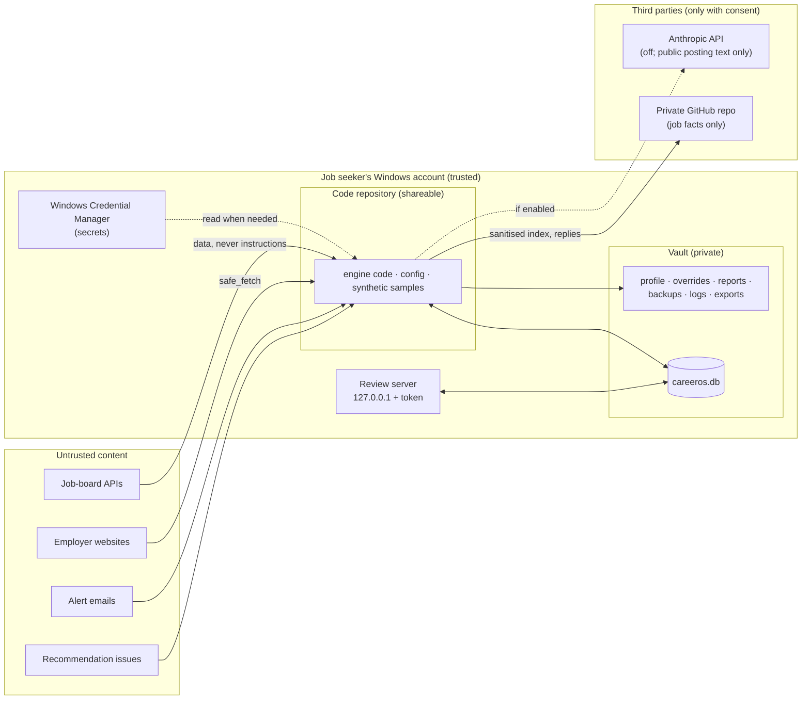

# CareerOS: security architecture

- Version: 1.0
- Date: 2026-10-13
- Companions:
  - `architecture.md`;
  - `business_requirements.md` (SEC-, PRIV-, AUD- requirements);
  - `requirements_traceability.md` (the test behind each control).

## 1. What is protected

| Asset | Why it matters | Where it lives |
|---|---|---|
| The job seeker's private data: profile, pay floor, policy overrides, labels, applications, decisions, reports, exports | Personal and career-sensitive | The vault, outside the code repository |
| Secrets: Gmail refresh token, IMAP app password, Anthropic API key | Access to a mailbox and a paid API | Windows Credential Manager only |
| Integrity of decisions and history | Every recommendation must be explainable and untampered | `careeros.db`: append-only history and a hash-chained audit log |
| The job seeker's reputation and employment | An automated application, message or scrape could cause harm | No code that applies or contacts employers or recruiters exists, and sites the job seeker must not touch are never fetched |
| Third-party systems | Polite, permitted access only | Host allowlists, budgets, site policy, robots.txt |

## 2. Trust boundaries

Everything that arrives from outside is **untrusted data**: postings, emails, issue text, web pages, board names. It
is parsed, escaped and stored. It is never executed, and it can never change the policy, the scores, or which hosts
CareerOS contacts.

## 3. Threats and controls

| Threat | Control | Code | Tested by |
|---|---|---|---|
| A URL from a lead or research points CareerOS at an internal address (SSRF) | `safe_fetch`: https and port 443 only, no IP or internal host names, every resolved address must be public (incl. 169.254.169.254), connections pinned to the checked address, each redirect re-checked, off-domain hops never fetched | `discovery/safe_fetch.py` | `test_board_verification`: `test_t19_*`, `test_t20_*`, `test_urls_that_are_never_fetched`, `test_connections_are_pinned_to_the_checked_address` |
| Text in a posting, email, issue or page tries to steer CareerOS | Content is data: escaped in the report; notes parsed as `key=value` facts that never change a decision; discovery hosts come only from the allowlist | `review/report.py`, `discovery/note.py`, `discovery/site_inspect.py` | `test_t22_instructions_written_into_a_careers_page_are_only_data`, `test_external_text_cannot_point_discovery_at_other_hosts_or_change_policy`, `test_issue_lines_carry_structured_notes_and_a_note_can_never_change_a_decision` |
| A board that is not the employer's is admitted (impostor, same name) | The employer's own site must point to the board, and the board must agree on identity, with trust ≥ 85, quarantine and a validation scan; approvals cannot override a mismatch | `discovery/board_verifier.py`, `board_registry.py` | `test_board_verification` (`t01`-`t30`); ADR 0001, 0003 |
| The job-board client is redirected to another host | Every request and redirect hop is checked against the four listing-API hosts; proxy variables in the environment are ignored | `discovery/http.py` | `test_redirects_outside_the_allowlist_are_refused`, `test_the_daily_scan_never_follows_a_board_redirect_off_the_listing_apis`, `test_the_job_board_client_ignores_the_environment` |
| Secrets leak through the repository, logs or database | Secrets live only in Credential Manager; the repository is scanned for keys and personal addresses; logs are redacted | `core/credentials.py`, `core/redact.py` | `test_repository_has_no_secrets_or_personal_contact_data`, `test_personal_data_removed_ids_kept`, `test_github_and_google_token_shapes_are_removed`, `test_connect_stores_only_in_the_credential_store` |
| Private data leaves the machine | The vault cannot sit inside the repository; replies and the published index carry job facts only; the AI reader gets public posting text only; a private analytics export is refused inside the repository | `paths.py`, `seen_index.py`, `extract/ai.py`, `cli.py: cmd_export` | `test_vault_cannot_live_inside_the_repo`, `test_job_facts_only`, `test_request_shape_and_only_public_posting_is_sent`, `test_a_private_export_never_goes_into_the_code_repository` |
| A web page in the browser drives the local review server (CSRF, DNS rebinding) | 127.0.0.1 only, a secret token on every request, a Host header check, one-time form keys bound to an action and a target, idempotent writes | `review/server.py` | `test_token_host_and_form_key_required` |
| History is altered after the fact | Append-only tables enforced by triggers; a hash-chained audit log; per-component write permissions; transitions that fail closed | `db/store.py`, `db/schema/*.sql` | `test_history_tables_are_immutable`, `test_event_chain_detects_tampering`, `test_separation_of_duties`, `test_projection_mismatch_fails_closed`; `careeros verify` |
| CareerOS acts on the job seeker's behalf | No component submits applications or sends messages; applications are recorded by a person | (no such code) | HR-006 (by design); ADR 0007 |
| Sites the job seeker must not automate are scraped | Site policy (`allowed` / `manual` / `blocked`); a never-fetch list for aggregators, LinkedIn, Indeed, Glassdoor, the job seeker's employer and manual-only systems, with the job seeker's own entries read from the vault; robots.txt; no CAPTCHA handling | `config/site_policy.yaml`, `discovery/sources.py`, `safe_fetch.NEVER_FETCH`, `core/private_sites.py` | `test_a_source_that_is_not_allowed_is_never_fetched`, `test_a_job_site_or_a_never_automated_site_is_not_an_official_domain`, `test_private_domains_are_never_fetched`, `test_demo_mode_never_reads_the_file`; ADR 0006 |
| Third-party APIs are overloaded | Request budgets (global and per provider), pacing, `Retry-After` honoured, a long wait reported rather than slept through | `discovery/http.py`, `source_health.py` | `test_budget_caps_every_request`, Functional MVP failure checks |
| A demonstration exposes private data | Demo Mode refuses the private vault, network, credentials, mail, GitHub, clipboard, AI and notifications, and fails closed without the synthetic world | `demo/sandbox.py` + guards | `tests/test_demo_mode.py` (network and credential jail, private-vault fingerprint); ADR 0004 |
| A demo or sample file carries real data | Demo exports are checked for fictional `example.com` addresses and websites only; the repository secret scan | `analytics/export.py: synthetic_only` | `test_the_demo_export_is_valid_synthetic_and_reconciles_with_the_application` |

Every control in this table is also covered by a deliberate-defect check in `tools/mutate.py`: the control is broken
in a scratch copy, and the test suite must fail.

## 4. Secrets

| Secret | Stored as | Used by | Notes |
|---|---|---|---|
| Gmail OAuth refresh token | Credential Manager `CareerOS/gmail` | `discovery/gmail.py` | Scope `gmail.readonly`. The job seeker creates the OAuth client and consents in their own browser. |
| Gmail app password | Credential Manager `CareerOS/gmail-imap` (stored by the job seeker with `cmdkey`) | `discovery/imap.py` | Opened read-only (EXAMINE, `BODY.PEEK`). A job-search-only account is recommended. |
| Anthropic API key | Credential Manager `CareerOS/anthropic`, or `ANTHROPIC_API_KEY` | `extract/ai.py` | AI reading is off in the job seeker's policy. |
| GitHub access | The `gh` CLI's own sign-in | `discovery/github_inbox.py` | CareerOS never sees or stores the token. |
| Review server token | Generated per session | `review/server.py` | Local only. |

No secret is written to the repository, the database, a report or a log. In Demo Mode, the credential store refuses to
open at all.

## 5. Outbound connections

| Destination | When | Limit |
|---|---|---|
| `boards-api.greenhouse.io`, `api.lever.co`, `api.ashbyhq.com`, `apply.workable.com` | Daily scans, discovery and validation | Allowlist on every hop, request budgets, pacing |
| Employer websites (`https`, public addresses) | Board verification, when `board_verification.fetch_official_sites` is on | Page budget per employer and per day, robots.txt |
| `gmail.googleapis.com` / `imap.gmail.com` | Daily run, once connected | Read-only |
| `github.com` (through `gh`) | Daily run, when an inbox repository is configured | The private repository only |
| `api.anthropic.com` | Only if AI reading is enabled | A daily call cap; posting text only |

Nothing else is contacted. Links to LinkedIn, Indeed, Glassdoor and other non-automated sites are kept as leads for a
person to open.

## 6. Data at rest

| Data | Location | Protection |
|---|---|---|
| Database, profile, overrides, reports, logs, exports | Vault folder | The Windows account's file permissions. The vault may not sit inside the repository. |
| Backups | `vault\backups\<date>` | Integrity-checked SQLite copy with a SHA-256 manifest; 14 kept |
| Analytics export | `vault\exports\analytics` | Private; refused inside the repository |
| Power BI report on private data | The job seeker's choice | Kept in the vault; never published |
| Demo data and samples | `%TEMP%\careeros-demo-vault`, `samples/analytics_demo/` | Synthetic only (`example.com`) |

## 7. Residual risks and assumptions

- **The Windows account is trusted.** Anyone signed in as the job seeker can read the vault. Disk encryption
  (BitLocker) and an offsite backup are the job seeker's decisions; backups currently sit on the same disk.
- **Gmail's read-only scope covers the whole mailbox.** The sender filter is CareerOS's own restriction, not
  Google's. A dedicated job-search mailbox reduces the exposure.
- **Lead matching still relies on discovery's older identity flag** (`board_discovery._record_match`). It could grade
  one lead's posting from a board that board verification has not admitted. This is recorded in
  `functional_mvp_report.md`, section 6, and should be reviewed before lead enrichment is relied on.
- **The runtime install is pinned by version only** (`requirements.lock`; PyYAML 6.0.2, httpx 0.27.2, anthropic 1.8.0
  and their dependencies). The development and CI set, `requirements-dev.lock`, is hash-locked, and pip-audit checks
  both (since 2026-10-13).
- **Power BI Desktop's auto-recovery files** can hold report data. A report opened on private data should be treated
  like the vault.
- **The review server token** is visible to processes running as the same user. That is acceptable for a local,
  single-user tool.
